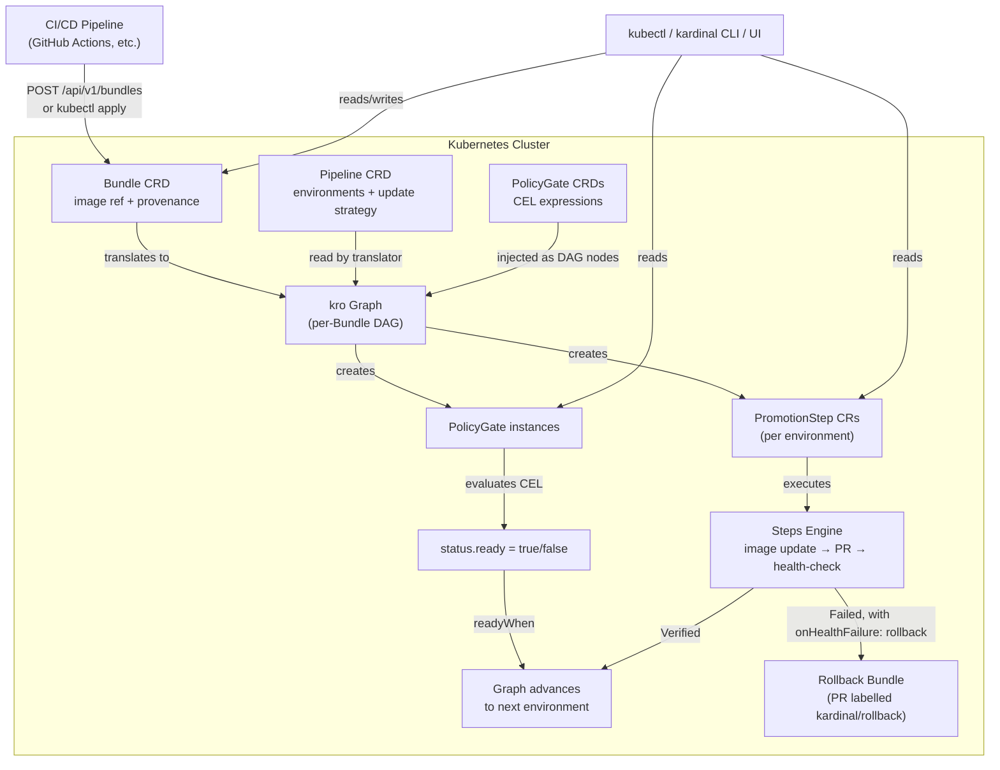
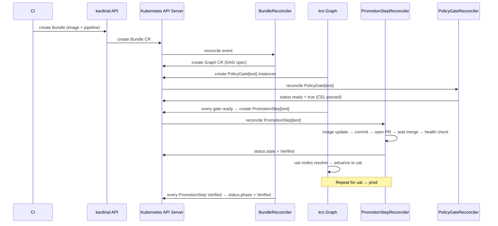

# Architecture

kardinal-promoter is a Kubernetes-native controller. All state lives in etcd as CRDs. The CLI, UI, and webhook API are convenience layers that create and read CRDs — you can operate the entire system with `kubectl`.

---

## System Overview



---

## Core Components

### Controller (`cmd/kardinal-controller`)

The controller manager runs these reconcilers:

| Reconciler | CRD | Responsibility |
|---|---|---|
| `BundleReconciler` | `Bundle` | Calls the translator to build a kro Graph; watches Graph status |
| `PipelineReconciler` | `Pipeline` | Validates pipeline config; computes aggregate pipeline status |
| `PromotionStepReconciler` | `PromotionStep` | Runs the steps engine: git-clone → image update → PR → health check |
| `PolicyGateReconciler` | `PolicyGate` (instances) | Evaluates CEL expression; writes `status.ready` |
| `MetricCheckReconciler` | `MetricCheck` | Queries Prometheus, Datadog, CloudWatch, New Relic or a JSON web API; writes result to status |
| `PRStatusReconciler` | `PRStatus` | Polls SCM for PR merge/close signal; writes `status.merged`, `status.mergeCommitSHA` (or `status.mergeCommitUnavailable` once it stops asking for it) and, for a 401/403/404/410, `status.pollError` |
| `RollbackPolicyReconciler` | `RollbackPolicy` | Reads one Bundle's PromotionSteps in one environment; creates a rollback Bundle at the failure threshold |
| `ScheduleClockReconciler` | `ScheduleClock` | Writes `status.tick` on a configurable interval for time-based gates |
| `ChangeWindowReconciler` | `ChangeWindow` | Writes `status.active` and requeues at the next window boundary |
| `SubscriptionReconciler` | `Subscription` | Polls OCI/Git sources; creates Bundles on new artifacts |
| `NotificationHookReconciler` | `NotificationHook` | Sends webhooks for the events it selects; writes delivery status |
| `HookRunReconciler` | `HookRun` | Runs a Pipeline hook's Job and records its result ([Pipeline hooks](hooks.md)) |
| `ImageVerificationReconciler` | `ImageVerification` | Checks the signatures of a Bundle's images (sigstore) and of a config Bundle's commit; writes the verdict to its status |
| `ScmProviderReconciler` | `ScmProvider`, `ClusterScmProvider` | Checks the provider's settings and Secrets; writes its `Ready` condition ([SCM providers](scm-providers.md)) |
| `RenderRunReconciler` | `RenderRun` | Runs a `layout: branch` environment's render in a sandboxed Job and records the rendered commit ([Rendered manifests](rendered-manifests.md)) |
| Audit retention (`pkg/reconciler/auditretention`) | `AuditEvent` | Deletes records past `audit.retention` (on by default; `audit.retention.enabled: false` turns it off) |
| Graph cleanup (`pkg/reconciler/graphcleanup`) | kro `Graph` | Deletes reader RoleBindings no Graph needs any more; lets a Graph in a terminating namespace go once kro can no longer tear it down |

### Translator (`pkg/translator`) and Graph builder (`pkg/graph`)

The translator collects what a Bundle's Graph needs (the Pipeline, its PolicyGate templates, analysis templates, the SCM provider) and the builder in `pkg/graph` turns it into a [kro](https://github.com/kubernetes-sigs/kro) `Graph` spec. The Graph encodes the full promotion DAG:

- One node per `PromotionStep` (environment)
- PolicyGate instances and PRStatuses as `forEach` collection nodes, one item per gate or environment
- `readyWhen` expressions wired so the Graph controller advances nodes in dependency order

[Graph coverage](graph-coverage.md) lists what the Graph decides and what stays in a reconciler.

### kro Graph Controller (`kro-system`)

kardinal-promoter does **not** implement graph coordination itself. It delegates to the
[kro](https://github.com/kubernetes-sigs/kro) Graph controller (`kro.run/v1alpha1` `Graph`,
`GraphKind` feature gate), which manages the DAG lifecycle:

- Creates owned resources (PromotionStep CRs, PolicyGate CRs) in topological order
- Advances to the next node when `readyWhen` is satisfied
- Stops the DAG on failure, preventing downstream promotions

> **Dependency note**: kardinal-promoter requires kro v0.10.0-rc.0+ with the Graph controller enabled.
> See [Installation](installation.md#install-kro) for setup.

### Steps Engine (`pkg/steps`)

The `PromotionStepReconciler` runs a sequence of built-in steps for each environment:

```
git-clone  →  kustomize-set-image  →  git-commit  →  git-push  →  [open-pr  →  wait-for-merge]  →  health-check
```

`open-pr` and `wait-for-merge` run only for `approval: pr-review`. `update.strategy: helm`
uses `helm-set-image` instead of `kustomize-set-image`, config Bundles use `config-merge`,
mixed Bundles run `config-merge` and then the image update step,
and `update.strategy: argocd` runs only `argocd-set-image` and `health-check`
(`pkg/steps/defaults.go`). The sequence is picked when the step leaves Pending and recorded in
`status.steps`; every later reconcile runs the recorded list, not one rebuilt from the live
Pipeline.

Built-in step implementations:

| Step | Description |
|---|---|
| `git-clone` | Clones the GitOps repo into a work directory owned by this PromotionStep (one per namespace, Pipeline, Bundle and environment). For config Bundles it also checks out the `configRef` commit into a separate directory next to it |
| `kustomize-set-image` | Edits the environment's `kustomization.yaml` `images:` list the way `kustomize edit set image` does (no binary needed) |
| `render` | `layout: branch` only, in the controller: asks for the environment's RenderRun and waits for its result (the commit pushed, the DRY commit rendered). The render itself (`git-clone`, the image update, `render-manifests`, `git-commit`, `git-push`) runs in the RenderRun's sandboxed Job, never in the controller ([Rendered Manifests](rendered-manifests.md)) |
| `render-manifests` | `layout: branch` only, in the render Job (`kardinal-render`; it refuses to run anywhere else): renders the environment path of the DRY checkout (kustomize, or Helm for a chart), checks the rendered branch for drift against `.kardinal/rendered.yaml`, and writes one file per object into the rendered branch checkout that `git-commit` commits |
| `helm-set-image` | Updates `values.yaml` image tag for Helm-based repos |
| `argocd-set-image` | Patches the Argo CD Application's image override directly, with no Git commit (`update.strategy: argocd`) |
| `config-merge` | Copies the environment directory of the Bundle's `configRef` commit over the environment directory (config and mixed Bundles). Files deleted in the config commit are not deleted |
| `git-commit` | Commits the working tree changes. When nothing changed it records that, and the later steps skip the push and the PR |
| `git-push` | A sequence with `open-pr` (`pr-review` when the step started): force-pushes `kardinal/<namespace hash>/<bundle>/<env>`, so a re-run after a restart replaces the earlier push. Otherwise (`auto`): pushes the base branch; if it moved, replays the promotion's files onto the new head and pushes again (up to 6 times, no wait), then restarts the sequence from a fresh clone (at most 3 times per reconcile), then retries the step with jittered backoff. While a PR waits for its merge, a moved base branch rebuilds the PR branch on the new head |
| `open-pr` | Opens a pull request via the SCM provider with promotion evidence |
| `wait-for-merge` | Polls `PRStatus` until the PR is merged or closed |
| `health-check` | Queries Kubernetes Deployment readiness or ArgoCD/Flux/Rollouts/Flagger sync status |

There is no custom step engine: every environment runs one of these sequences, and the API
server rejects a Pipeline that sets the deprecated `spec.environments[].steps` or
`promotionTemplate`. For image signature
checks and tests, see [Pipeline Reference: Image signatures and tests](pipeline-reference.md#image-signatures-and-tests).

### PolicyGate Evaluator (`pkg/reconciler/policygate`)

Evaluates CEL expressions against the promotion context, with the `json.*`, `maps.*`,
`lists.*` and `random.*` functions adapted from the
[kro CEL library](https://github.com/kubernetes-sigs/kro/tree/main/pkg/cel/library)
(`pkg/cel/library`) and the standard string extensions.

See [CEL Context Reference](reference/cel-context.md) for the full variable list.

### SCM Provider (`pkg/scm`)

Abstracts Git hosting operations. Current implementations:

| Provider | Status |
|---|---|
| GitHub | GA |
| GitLab | Beta |
| Forgejo, Gitea | Beta |
| Bitbucket Cloud, Azure DevOps | Newer, less tested |

The provider is chosen for the whole controller with `--scm-provider`; see
[SCM Providers](scm-providers.md).

### Health Adapters (`pkg/health`)

Checks whether a promotion is healthy after merging:

| Adapter | Status |
|---|---|
| Kubernetes `Deployment` readiness | GA |
| ArgoCD `Application` sync status | GA |
| Argo Rollouts `Rollout` status | Beta |
| Flux `Kustomization` ready status | GA |
| Flagger `Canary` phase | Beta |

---

## Data Flow: Bundle → Verified



---

## Bundle lifecycle

### When a Failed Bundle promotes again

A Bundle is Failed when a promotion step or health check failed, kro rejected the Graph, or the
Pipeline, the Bundle (its intent, or no images or config commit for its type) or a PolicyGate
cannot be built into a Graph (condition `InvalidSpec`, with the reason). It promotes again when
the failed step is retried or, for `InvalidSpec`, when the Pipeline changes or, for reason
`GraphBuildFailed`, a PolicyGate that applies to one of its environments changes.

### Bundle supersession

When a newer Bundle of the same type is created for the same Pipeline, an older Bundle that is
still waiting or promoting (`Available` or `Promoting`) is **superseded**. A `Failed` Bundle
stays `Failed`; if it would resume, a newer Bundle supersedes it instead. The new Bundle starts
promoting from the beginning, and the older one:

- The older Bundle's status transitions to `Superseded`, which is final
- None of its PromotionSteps pushes any more: right before every `git-push` a step reads its
  Bundle from the API server and fails ("promotion cancelled") if the Bundle is Superseded or
  rejected. A push to the environment's branch is also refused when a Bundle that supersedes it
  (newer, of the same type, neither rejected nor Failed) has already pushed there (each such push
  first records `status.outputs.pushIntent`), so an older image never lands over a newer one: that
  step ends `Superseded`, and so does its Bundle, which no failure count (Bundle failure,
  `maxUnavailable`, DORA, `onHealthFailure`) includes
- Its unfinished PromotionSteps are failed, and a PR one of them opened that is still
  open is closed with a comment and its head branch
  (`kardinal/<namespace hash>/<bundle>/<env>`) is deleted, so the closed PR cannot be merged
  later. If the SCM fails to close it or to delete its branch, the
  step keeps its state and retries after 10s, 20s, 40s, 80s and 2m, with the
  `SupersededCloseFailed` condition `True` and `status.nextRetryAt`; after the last retry it
  fails, and its message says to close the PR (or delete its branch) by hand
- Its Graph, PromotionSteps and PolicyGates are kept as history until the Graph is retired
  ([Graph retirement](#graph-retirement)), but the Graph creates no new PromotionStep,
  and its PolicyGates are no longer evaluated: they keep the status they had when the
  Bundle was superseded
- A step the Graph created just before the Bundle was superseded, and that never started,
  is failed with "superseded before this step started" and writes no AuditEvent
- Deleting the Bundle deletes its Graph and everything the Graph created, and closes, with a
  comment, a PR one of its steps opened that is still open

Supersession is tracked independently by Bundle type. A new `image` Bundle does not
supersede an in-flight `config` Bundle, and vice versa.

```bash
kardinal get bundles my-app
# BUNDLE         TYPE    PHASE        AGE
# my-app-7xk2p   image   Superseded   10m
# my-app-9qd4s   image   Promoting    3m
```

### Graph retirement

kro keeps every Graph in memory, so kardinal does not keep the Graph of every finished Bundle.
Once a Bundle has finished, and every one of its PromotionSteps has settled (`Verified`, `Failed`,
`RollingBack`, `AbortedByAlarm` or `Superseded`, with no PR left to close), its Graph is **retired** after a delay
that starts when the last step settles:

| Bundle | Retired after (chart value, controller flag) |
|---|---|
| Superseded, or Verified and replaced in every environment by a newer Verified Bundle of the same type | 1m (`graph.retire.superseded`, `--graph-retire-superseded-after`) |
| Verified and still deployed in an environment | 1h (`graph.retire.verified`, `--graph-retire-verified-after`) |
| Failed, unless a newer Verified Bundle replaced it in every environment it touched (then the first row); or not Superseded with a step stopped by a health alarm (`AbortedByAlarm`, which waits for a person to resume or roll back) | 24h (`graph.retire.failed`, `--graph-retire-failed-after`) |

When a Bundle turns Verified, the older Verified and Failed Bundles of its Pipeline and type are
checked again, so one it replaced everywhere retires after the first delay. `0s` keeps those Graphs;
with all three at `0s` only the Bundles of Pipelines that set the annotation below are retired. A negative flag stops the controller at startup. The
annotation `kardinal.io/graph-retire-after: <duration>` on a Pipeline replaces all three delays for
its Bundles (`"0"` keeps them); a value that is not a duration is ignored, named in the
`GraphRetired` condition and in a Warning Event `InvalidRetireDelay`.

Retiring writes one record per PromotionStep to the Bundle's `status.retiredSteps` (name,
environment, step type, final state and message, PR URL, creation and Verified times, health check
expiry), sets the condition `GraphRetired` to `True`, and deletes the Graph. kro then deletes the
Graph's PromotionSteps, PolicyGate instances and PRStatuses. `GraphRetired` is `Unknown` with
reason `WaitingForSteps` while a step has not settled, and `False` with reason `Scheduled` while the
delay runs. A Bundle with more than 1,000 PromotionSteps, or whose records would take more than
512 KiB, keeps its Graph (reason `TooManySteps`).

What a retired Bundle keeps and loses:

- **Kept**: rollback and `kardinal promote` (which Bundle is deployed where, which were Verified),
  `kardinal history`, `kardinal metrics` and the Pipeline's `status.deploymentMetrics`, the
  Pipeline phase, `kardinal status`, `kardinal explain` and `kardinal get pipelines`, the UI's
  graph and step list (state, message and PR link per environment), `status.environments`, and
  the AuditEvents, which never belonged to the Graph.
- **Lost**: the PolicyGate instances (gate results and overrides; the AuditEvents keep each
  evaluation), the PRStatuses, a step's per-step detail (`status.steps[]`, outputs other than the
  PR URL) and its Kubernetes Events.
- A retired Bundle is final: a retired Failed Bundle no longer recovers, and a Pipeline change
  does not rebuild it. Roll back or create a new Bundle instead.

`spec.historyLimit` still decides how many finished Bundles, and so how many records, a Pipeline
keeps.

---

## How kardinal Relates to ArgoCD and Flux

kardinal-promoter is **GitOps-agnostic**: with the `kustomize` and `helm` update strategies
it only writes to Git. Instead of talking to Argo CD or Flux:

1. `PromotionStepReconciler` opens a Git pull request with the updated image reference.
2. A human (or automated process) merges the PR.
3. ArgoCD or Flux detects the Git change and syncs the cluster.
4. kardinal's **health check** then queries ArgoCD or Flux to confirm sync is complete
   before advancing the DAG.

This means kardinal works with any GitOps engine — or even without one (raw Kubernetes deployments).

The exception is `update.strategy: argocd`, which patches the Argo CD `Application`
directly instead of committing to Git. It needs the chart's
`rbac.argocdApplicationsWrite=true` (see [Argo CD native promotion](argocd-native-promotion.md)).

---

## State Management

All state is stored in Kubernetes CRDs:

| CRD | Purpose |
|---|---|
| `Pipeline` | Defines environments, update strategy, SCM config |
| `Bundle` | Immutable deployment unit; created by CI |
| `PromotionStep` | Per-environment promotion progress; owned by Graph |
| `PolicyGate` | Namespaced policy check: templates, and the per-Bundle instances the Graph creates |
| `PRStatus` | Tracks a promotion PR's open, merged or closed state |
| `RollbackPolicy` | Consecutive-failure rollback trigger for one Bundle in one environment (user-created; see [Rollback](rollback.md#autorollback-is-not-implemented)) |
| `MetricCheck` | Metric query (Prometheus, Datadog, CloudWatch, New Relic, web) with a pass/fail threshold, created by the user or, per promotion, by the Graph from a `perPromotion` template; gates read it as `metrics.<name>` |
| `ScheduleClock` | Writes `status.tick` on a configurable interval; enables time-based policy gates |
| `ChangeWindow` | Cluster-scoped blackout/recurring allow windows for pipeline promotions |
| `Subscription` | Watches OCI registries or Git repos; auto-creates Bundles on new artifacts |
| `NotificationHook` | Sends promotion events to a webhook URL |
| `AuditEvent` | Append-only record of promotion events (see [Security](guides/security.md#audit-logging)) |

There is no database. The controller is **stateless**: it can be restarted at any time without
data loss, and every reconciler is idempotent. All state is recovered by re-reading CRDs.

---

## Further Reading

- [Graph Coverage](graph-coverage.md) — what runs on the kro Graph today and what does not yet
- [Concepts](concepts.md) — Bundles, Pipelines, PolicyGates explained
- [Policy Gates](policy-gates.md) — CEL expression reference
- [CEL Context Reference](reference/cel-context.md) — variables available in gate expressions
- [Installation](installation.md) — how to install kardinal-promoter
