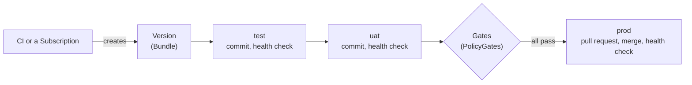

# Concepts

kardinal moves a **version** of your application through a **pipeline** of **environments**,
and **gates** decide when the version may enter the next environment. Those four words are
all you need to start; the [glossary](reference/glossary.md) maps every other term to them.



Each box on the right is an **environment** of the **pipeline**. A version enters an
environment once the environment before it has verified it and the environment's gates pass.
kardinal then writes the version to the environment's directory in your GitOps repository
(directly, or through a pull request you review), waits for Argo CD, Flux or Kubernetes to
roll it out, and checks its health. A healthy environment is **Verified**, and the version
moves on.

## Version (Bundle)

A **version** is one immutable snapshot of what to deploy: container images (tag and digest),
or a Helm chart version, or a commit of a configuration repository, together with where it
came from (author, commit, CI run). Its Kubernetes kind is `Bundle`, and the CLI and the UI
call it a Bundle too.

Your CI creates a version after it builds and pushes an image. Every way of creating one
produces the same object:

```bash
# From CI, through the Bundle API
curl -X POST https://kardinal.example.com/api/v1/bundles \
  -H "Authorization: Bearer $TOKEN" \
  -d '{"pipeline":"my-app","type":"image","images":[{"repository":"ghcr.io/myorg/my-app","tag":"1.29.0","digest":"sha256:abc..."}],"provenance":{"commitSHA":"abc123","ciRunURL":"https://...","author":"engineer"}}'

# From the CLI
kardinal create bundle my-app --image ghcr.io/myorg/my-app:1.29.0

# With kubectl
kubectl apply -f bundle.yaml
```

A version cannot change: the API server refuses an update to its images, chart, config
commit, provenance, pipeline or intent (`spec.<field> is immutable: create a new Bundle`),
because gates and health checks were decided for that artifact. Labels and annotations stay
editable. To ship something else, create a new version. A newer version of the same type
replaces, or **supersedes**, an older one that has not finished; see
[Bundle supersession](architecture.md#bundle-supersession).

### Version types

- **`image`** (default): References container image tags. The promotion updates image references in manifests using `kustomize-set-image` or `helm-set-image`. The Bundle API (`POST /api/v1/bundles`) and `kardinal create bundle` use it when `type` is omitted; a Bundle applied with kubectl must set `type`.
- **`config`**: References a Git commit SHA from a configuration repository. The promotion merges that commit's changes into each environment directory. This supports promoting configuration changes (resource limits, env vars, feature flags) independently from image changes.

Image Bundle:
```yaml
spec:
  type: image
  pipeline: my-app
  images:
    - repository: ghcr.io/myorg/my-app
      tag: "1.29.0"
      digest: sha256:a1b2c3d4...
```

Config Bundle:
```yaml
spec:
  type: config
  pipeline: my-app
  configRef:
    gitRepo: https://github.com/myorg/app-config
    commitSHA: "abc123def456"
```

Both types go through the same pipeline, the same gates and the same pull request flow.
For a config or mixed Bundle, the `config-merge` step copies the environment's directory
(`environments/<name>` or `environments[].path`) from the `configRef` commit over the
same directory in the GitOps repo. Nothing outside that directory is copied, and files
deleted in the config commit are not deleted.

[`examples/config-promotion/`](https://github.com/pnz1990/kardinal-promoter/tree/main/examples/config-promotion)
has a Pipeline and a config Bundle.

### How far a version goes

The `spec.intent` field declares how far the Bundle should be promoted:

```yaml
spec:
  intent:
    targetEnvironment: prod   # promote through all environments up to and including prod (default)
```

```yaml
spec:
  intent:
    targetEnvironment: staging  # stop after staging, do not proceed to prod
```

```yaml
spec:
  intent:
    skipEnvironments: [staging]  # skip staging (if an org gate applies to staging, a skip-permission gate in an org policy namespace must allow it; see Skip permissions)
```

The intent is set when the Bundle is created and cannot be changed afterwards. To change the
target, create a new Bundle (or use `kardinal promote`, which creates one).

### Version phases

| Phase | Meaning |
|---|---|
| Available | Created, not yet in any environment |
| Promoting | Moving through the pipeline |
| Verified | Verified in every environment it targets |
| Failed | A promotion or health check failed, or the Pipeline, the version or a gate is invalid (condition `InvalidSpec`, with the reason). It promotes again when the failed promotion is retried or the invalid object is fixed ([details](architecture.md#when-a-failed-bundle-promotes-again)) |
| Superseded | A newer version of the same type replaced it before it finished |
| Rejected | Rejected with `kardinal reject`: never promoted again, and rollback never picks it. See [Reject a Bundle](rollback.md#reject-a-bundle) |

## Pipeline and environments

A **pipeline** is the promotion path of one application: the Git repository that holds its
manifests, its **environments**, and the order they promote in. Its Kubernetes kind is
`Pipeline`.

```yaml
apiVersion: kardinal.io/v1alpha1
kind: Pipeline
metadata:
  name: my-app
spec:
  git:
    url: https://github.com/myorg/gitops-repo
    secretRef: { name: github-token }
  environments:
    - name: dev
      path: environments/dev
      approval: auto
    - name: staging
      path: environments/staging
      approval: auto
    - name: prod
      path: environments/prod
      approval: pr-review
```

Environments promote sequentially by default (dev, then staging, then prod). For parallel fan-out, use `dependsOn`:

```yaml
  environments:
    - name: staging
    - name: prod-us
      dependsOn: [staging]
      approval: pr-review
    - name: prod-eu
      dependsOn: [staging]
      approval: pr-review
```

Both prod regions promote in parallel after staging is verified.

Wave numbers (`wave`) and [fleets](pipeline-reference.md#fleets) promote many environments in
parallel; see the [Pipeline reference](pipeline-reference.md).

### Promotion steps

The promotion of one version into one environment is a **promotion step** (kind
`PromotionStep`; the UI calls it a stage). kardinal creates them; you do not. A step clones
the repository, updates the image, commits, pushes or opens a pull request, waits for the
merge, and checks health. Its state is one of Pending, Promoting, WaitingForMerge,
HealthChecking, Verifying (the environment's [post-deploy hooks](hooks.md) run), Verified,
Failed, AbortedByAlarm, RollingBack or Superseded (a newer version had already reached the
environment; not a failure). `kardinal get steps <pipeline>` lists them.

The sequence is fixed per environment: it follows from `update.strategy` and `approval`.
kardinal has no custom step engine; see
[Pipeline reference: Promotion steps](pipeline-reference.md#promotion-steps).

### Approval modes

| Mode | Behavior |
|---|---|
| `auto` | Manifests are pushed directly to the target branch. No PR. Promotion proceeds automatically when the upstream environment is verified. |
| `pr-review` | A PR is opened in the GitOps repo with promotion evidence (artifact provenance, policy gate compliance, upstream verification). A human reviews and merges. |

### Health checks

A step is Verified when its environment is healthy and runs the promoted version. `health.type`
picks what kardinal reads:

| Adapter | What it checks | When to use |
|---|---|---|
| `resource` | Deployment runs the Bundle images, is fully rolled out and `Available` | Clusters without a GitOps tool |
| `argocd` | Argo CD Application healthy and synced to the promoted commit | Argo CD users |
| `flux` | Flux Kustomization `Ready` with `lastAppliedRevision` at the promoted commit | Flux users |
| `argoRollouts` | Argo Rollouts Rollout phase | Canary/blue-green deployments |
| `flagger` | Flagger Canary phase (`Failed` fails the step at once) | Canary deployments |

When `health.type` is omitted the adapter is `resource`, or the `delivery.delegate` value when
that is set. See [Health checks](health-adapters.md).

### Several clusters

kardinal runs in one cluster, next to the Argo CD or Flux hub that manages your workload clusters. Declare one environment per cluster or region (for example `prod-eu` and `prod-us`) and promote them in parallel with `wave` or `dependsOn`. Each environment reads its health from its cluster through a kubeconfig Secret (`health.kubeconfigSecretRef`), or from the hub: `health.type: argocd` on its Application, or `health.type: flux` on a hub Kustomization that targets the remote cluster. See [Remote Clusters](health-adapters.md#remote-clusters).

## Gates (PolicyGate)

A **gate** holds a version out of an environment until its CEL expression is true. Its
Kubernetes kind is `PolicyGate`. Gates show in the UI's promotion graph and in
`kardinal explain`.

```yaml
apiVersion: kardinal.io/v1alpha1
kind: PolicyGate
metadata:
  name: no-weekend-deploys
  namespace: platform-policies
  labels:
    kardinal.io/scope: org
    kardinal.io/applies-to: prod
spec:
  expression: "!schedule.isWeekend"
  message: "Production deployments are blocked on weekends"
  recheckInterval: 5m
```

### How gates are applied

- **Org-level gates** (the controller's `--policy-namespaces`, default `platform-policies`) are injected into every Pipeline that targets the matching environment. Teams cannot remove them.
- **Team-level gates** (team namespace) are added alongside org gates. Teams can add their own restrictions.
- The `kardinal.io/applies-to` label names the environment the gate blocks. A label value cannot contain a comma, so a gate blocks one environment; create one gate per environment to block several.

### CEL context

PolicyGate expressions read the Bundle (`bundle.version`, `bundle.labels`, `bundle.provenance.*`,
`bundle.upstreamSoakMinutes`), the time (`schedule.isWeekend`, `schedule.hour`), the target
environment (`environment.name`), upstream soak and history (`upstream.<env>.*`), MetricCheck
results (`metrics.*`), change windows (`changewindow.*`) and approvals (`approvals.*`).
Referencing an attribute that does not exist blocks the gate. See the
[CEL context reference](reference/cel-context.md) for the full list.

### Inspecting gates

```bash
# See which gates are blocking a promotion
kardinal explain my-app --env prod

# Output:
# ENVIRONMENT   BUNDLE         TYPE         NAME                 STATE   EXPRESSION                         REASON
# prod          my-app-9tptr   PolicyGate   staging-soak         Block   bundle.upstreamSoakMinutes >= 30   bundle.version=1.29.0: bundle.upstreamSoakMinutes >= 30 = false
# prod          my-app-9tptr   PolicyGate   no-weekend-deploys   Pass    !schedule.isWeekend                bundle.version=1.29.0: !schedule.isWeekend = true
#
# prod   deployed: my-app-7qvsr (1.28.0)
```

Gates that are not ready come first. STATE is Pass, Block (holding the
Bundle), Superseded, Rejected, Pending or Waiting; REASON is the controller's latest
evaluation. See [Inspecting PolicyGates](policy-gates.md#inspecting-policygates).

### Skip permissions

If a Bundle's `intent.skipEnvironments` lists an environment that an org gate applies to, the skip is denied unless a skip-permission PolicyGate allows it. Only a gate in an org policy namespace (the controller's `--policy-namespaces`, default `platform-policies`) can grant a skip; gates in the Pipeline's namespace or in `spec.policyNamespaces` never can.

```yaml
apiVersion: kardinal.io/v1alpha1
kind: PolicyGate
metadata:
  name: allow-staging-skip-for-hotfix
  namespace: platform-policies
  labels:
    kardinal.io/type: skip-permission
    kardinal.io/applies-to: staging
spec:
  skipPermission: true
  expression: 'bundle.version.startsWith("hotfix-")'
  message: "Hotfix bundles may skip staging"
```

When the skip is allowed, the permission's expression is evaluated in front of the next environment: that environment waits until the expression is true. When no such gate exists, the Bundle goes to phase `Failed` and its status conditions say `skip denied for environment "staging": ...`. See [Skip Permissions](policy-gates.md#skip-permissions).

## Under the hood

For each version, kardinal translates the Pipeline into a [kro Graph](https://kro.run/next/docs/concepts/graph/overview/):
one node per gate and per promotion step, in dependency order. kro's Graph controller creates
them, and kardinal's controllers run the steps and evaluate the gates. You never write a Graph;
the Pipeline is the interface. [Architecture](architecture.md) has the details, including
supersession and when a finished version's Graph is retired.

## Where next

- Create versions without CI: [Subscriptions](subscription.md) watch registries and Git.
- Commit rendered YAML instead of templates: [Rendered manifests](rendered-manifests.md).
- Multi-tenant setups, ephemeral environments and anti-patterns: [Patterns](advanced-patterns.md).
- Every transition is recorded as an `AuditEvent`: [Audit logging](guides/security.md#audit-logging).
