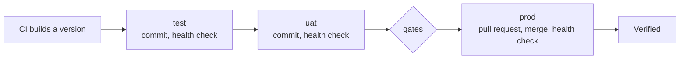

<div align="center" markdown>
  { width="200" }
</div>

# kardinal-promoter

**Promote every version of your app through test, uat and prod, with gates you can read.**

Your CI builds a version. kardinal moves it through your environments by writing to Git, and
gates decide when it may go further: no deploys on weekends, 30 minutes in uat first, two
approvers for prod. Every production change is a pull request that shows what is shipping, which
gates passed and how the earlier environments did. It works with Argo CD, Flux or plain
Kubernetes, and keeps all its state in Kubernetes.

```yaml
apiVersion: kardinal.io/v1alpha1
kind: Pipeline
metadata:
  name: my-app
spec:
  git:
    url: https://github.com/myorg/gitops-repo
    secretRef: { name: github-token }
  environments:
    - name: test
    - name: uat
    - name: prod
      approval: pr-review
```

```bash
kardinal create bundle my-app --image ghcr.io/myorg/my-app:1.29.0   # ship a version
kardinal explain my-app --env prod                                   # why is it not in prod yet?
```

<div class="grid cards" markdown>

-   :material-clock-fast:{ .lg .middle } **Try it in 10 minutes**

    ---

    A kind cluster, a sample repository and a first promotion.

    [:octicons-arrow-right-24: Quickstart](quickstart.md)

-   :material-shield-check:{ .lg .middle } **Gates you can read**

    ---

    Block weekends, require soak time, ask for approvers, read metrics, all in CEL.
    `kardinal explain` says which gate holds a version and why.

    [:octicons-arrow-right-24: Gate promotions](policy-gates.md)

-   :material-graph:{ .lg .middle } **Pipelines that fan out**

    ---

    Promote regions in parallel with `dependsOn` or waves, or many clusters with fleets.

    [:octicons-arrow-right-24: Design a pipeline](pipeline-reference.md)

-   :material-source-pull:{ .lg .middle } **Pull requests with evidence**

    ---

    Provenance, gate results and upstream health in every production PR.

    [:octicons-arrow-right-24: PR evidence](pr-evidence.md)

</div>

## How it works



1. **CI creates a version** with the new image and where it came from.
2. **Each environment in turn** gets the version written to Git (directly, or through a pull
   request), and kardinal checks its health.
3. **Gates hold the version** out of an environment until their rules pass.
4. **A pull request** is opened for review where an environment uses `approval: pr-review`, with
   the evidence in its body.

[Concepts](concepts.md) explains the four words this needs: version, pipeline, environment and
gate. To install, see [Install](installation.md). To compare with Kargo and GitOps Promoter, see
the [comparison](comparison.md).

## Community

- **GitHub Issues** — [report bugs or request features](https://github.com/pnz1990/kardinal-promoter/issues)
- **Contributing** — read [CONTRIBUTING.md](https://github.com/pnz1990/kardinal-promoter/blob/main/CONTRIBUTING.md) before opening a PR

