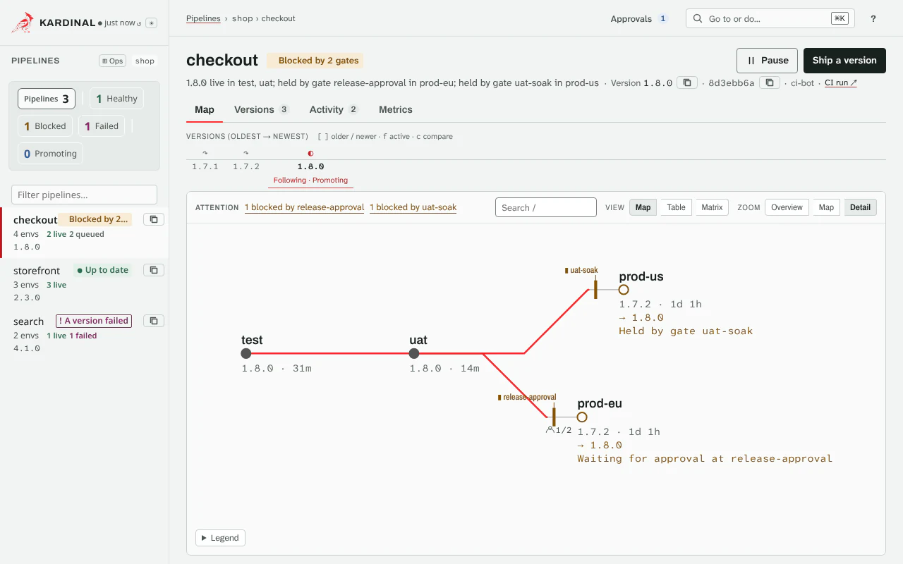

# Installation

This guide covers installing kardinal-promoter in a Kubernetes cluster using Helm.

---

## Prerequisites

| Requirement | Version | Notes |
|---|---|---|
| Kubernetes | ≥ 1.35 | kind, EKS, GKE, or any conformant cluster. `hack/install-kro.sh` and the chart refuse older clusters. CI tests 1.35, 1.36 and 1.37, and installs the CRDs and admission policies on 1.35 and the newest release |
| kubectl | ≥ 1.34 | Within one minor of your cluster |
| Helm | ≥ 3.14 | `brew install helm`. 3.14 adds `--reset-then-reuse-values`, used by [Upgrade](upgrade.md). A Helm whose default Kubernetes version is older than 1.35 (3.14 defaults to 1.29) fails the chart's `kubeVersion` in `helm template`: pass `--kube-version` with your cluster's version |
| GitHub token | — | Personal access token with `repo` scope |
| kro | ≥ 0.10.0-rc.0 | Graph controller with the `GraphKind` feature gate — see [Install kro](#install-kro) |

!!! tip "Trying it out locally?"
    Use [kind](https://kind.sigs.k8s.io/) for a single-node local cluster.
    See the [Quickstart](quickstart.md) for the fast path.

---

## Install kro

kardinal-promoter renders one kro [Graph](https://kro.run/next/docs/concepts/graph/overview/)
(`kro.run/v1alpha1`) per Bundle. [kro](https://github.com/kubernetes-sigs/kro) is a separate
prerequisite; the kardinal-promoter chart does not bundle it.

```bash
# From a kardinal-promoter checkout
bash hack/install-kro.sh
```

The script installs the kro Helm chart (`oci://registry.k8s.io/kro/charts/kro`) into `kro-system`
with `config.featureGates.GraphKind=true` and `rbac.mode=aggregation`, then server-side applies the
kro CRDs. Override the version with `KRO_VERSION=<version>`.

The script also tunes kro for kardinal's Graphs:

| Helm value | kro default | Script default | Override |
|---|---|---|---|
| `config.graphConcurrentReconciles` | 1 | 8 | `KRO_GRAPH_CONCURRENT_RECONCILES` |
| `config.clientQps` | 100 | 300 | `KRO_CLIENT_QPS` |
| `config.clientBurst` | 150 | 500 | `KRO_CLIENT_BURST` |
| `deployment.resources.limits.memory` | 1024Mi | 2Gi | `KRO_MEMORY_LIMIT` |
| `deployment.resources.requests.memory` | 128Mi | 768Mi | `KRO_MEMORY_REQUEST` |

kro reconciles one Graph at a time by default, and each reconcile makes about three API calls per
object the Graph applies. With one worker, one large promotion (a Pipeline with 150 environments)
delays every other Graph in the cluster by several seconds, up to about 30 seconds while two such
promotions run. Eight workers keep that under half a second. If you install kro another way, set
the same values.

## Install kardinal-promoter

### 1. Create the GitHub token secret

kardinal-promoter needs a GitHub personal access token to open and monitor pull requests.
The token requires the `repo` scope (contents read/write, pull requests read/write).

```bash
kubectl create namespace kardinal-system

kubectl create secret generic github-token \
  --namespace kardinal-system \
  --from-literal=token=<your-github-token>
```

### 2. Install with Helm

```bash
helm install kardinal-promoter oci://ghcr.io/pnz1990/charts/kardinal-promoter --version 0.12.1 \
  --namespace kardinal-system \
  --create-namespace \
  --set scm.secretRef.name=github-token
```

`scm.secretRef` and `scm.token` are the names for every `scm.provider`; `github.secretRef` and
`github.token` are their old names and keep working.

This installs the kardinal CRDs (from the chart's `crds/` directory), the **kardinal-promoter
controller** in the `kardinal-system` namespace, and the ClusterRoles bound to the Graph identity
(`<fullname>-graph-applier`; see [RBAC requirements](guides/security.md#rbac-requirements)).

Helm installs `crds/` only on the first install and never updates or deletes it. See
[Upgrade](upgrade.md) for how to update the CRDs.

The chart ships `values.schema.json`, which rejects unknown keys: a misspelled `--set` fails the
install instead of being ignored.

Create the Secrets first. The controller reads `scm.secretRef`, `webhook.secretRef`,
`bundleAPI.tokenSecretRef` and `ui.auth.tokenSecretRef` at startup, so a Pod whose Secret or key
is missing waits in `CreateContainerConfigError`, and `helm install --wait` would time out with
only `context deadline exceeded`. When Helm talks to the cluster (`helm install`, `helm upgrade`,
`--dry-run=server`), the chart looks each Secret up in the release namespace and fails at once
with the value, the Secret and the missing key, for example:

```
Error: INSTALLATION FAILED: ... scm.secretRef.name: Secret "github-token" does not exist in namespace kardinal-system. Create it before installing ...
```

The installer needs `get` on Secrets in the release namespace for this check. `helm template`
and client-side dry runs (which GitOps tools such as Argo CD use) have no cluster and skip it.

Verify both controllers are running:

```bash
kubectl get pods -n kardinal-system
# NAME                                              READY   STATUS    RESTARTS   AGE
# kardinal-promoter-6b6c8c8446-jc79g               1/1     Running   0          30s

kubectl get pods -n kro-system
# NAME                              READY   STATUS    RESTARTS   AGE
# kro-7d4b8f9f5-xk2pq               1/1     Running   0          30s
```

The controller is ready once it has built the agent index (`kubectl get agentindex`, Ready).
Until then, a few seconds after the install, the API server refuses new versions, Approvals and
gate overrides with "kardinal's agent index is not ready yet" ([Agents and the verified
actor](actors.md#how-the-actor-is-verified)).

### 3. Install the CLI

Download the `kardinal` binary of the same release. The release has builds for Linux and
macOS (`amd64`, `arm64`) and `kardinal-windows-amd64.exe`.

```bash
OS=$(uname -s | tr '[:upper:]' '[:lower:]')
ARCH=$(uname -m | sed -e 's/x86_64/amd64/' -e 's/aarch64/arm64/')
curl -Lo kardinal "https://github.com/pnz1990/kardinal-promoter/releases/download/v0.12.1/kardinal-${OS}-${ARCH}"
chmod +x kardinal && sudo mv kardinal /usr/local/bin/
kardinal version
# CLI:        v0.12.1
# Controller: v0.12.1
# Graph:      kro v0.10.0-rc.0
```

Keep the CLI and the controller on the same minor version. From v0.13.0 (unreleased), when they are a minor version apart,
each command that talks to the cluster prints one `warning: kardinal CLI ... talks to controller ...`
line on stderr, with the command that upgrades the older one ([`kardinal version`](reference/cli/kardinal-version.md)).

### Defaults for a repository

!!! info "New in v0.13.0 (unreleased)"
    v0.12.0 and earlier take the pipeline as an argument only. The [changelog](changelog.md) lists every change since v0.12.0.

Inside an application's repository you need not repeat its pipeline and namespace. Put them in a
`.kardinal.yaml` at the repository's root:

```yaml
pipeline: checkout
namespace: team-a
```

```bash
kardinal why prod
```

- **Where a default comes from.** A command that takes `<pipeline> [<env>]` (`why`, `explain`,
  `history`, `logs`, `ship`, `approve`, `promote`, `rollback`, `hold`, `unhold`, `pause`,
  `resume`, `override`, `verify`) takes the pipeline from its argument, then `KARDINAL_PIPELINE`,
  then the file's `pipeline`. The namespace comes from `-n`, then `KARDINAL_NAMESPACE`, then the
  file's `namespace`, then the kubeconfig context. The file is the nearest `.kardinal.yaml` from
  the working directory up to the git repository's root.
- **One argument.** With a default pipeline, `kardinal why prod` means its environment `prod` when
  it has one, else a pipeline named `prod`. When the cluster cannot say, the command refuses
  rather than guess.
- **Never silent.** Each default a command uses is printed once on stderr with its source, for
  example `using namespace team-a (from /src/app/.kardinal.yaml)`.
- **Never a cluster.** The file may set `pipeline` and `namespace` only, and any other key is an
  error: it never selects a context or a cluster. `kardinal mcp`'s tools never read it, because
  an agent's working directory may be a repository it does not trust.

See [kardinal](reference/cli/kardinal.md) for the details.

---

## Accessing the UI

The kardinal controller serves an embedded web UI at port `8082` (`--ui-listen-address`, Helm value `service.uiPort`).

### In-cluster access (recommended): kubectl port-forward

The chart's Service is `ClusterIP` and the chart creates no Ingress. Without an Ingress, `NodePort` or `LoadBalancer` Service of your own, use `kubectl port-forward`:

```bash
kubectl port-forward svc/kardinal-promoter -n kardinal-system 8082:8082
```

Then open <http://localhost:8082/ui/> in your browser. If you installed with a
release name that does not contain `kardinal-promoter`, the Service is named
`<release>-kardinal-promoter`.

!!! tip "Why port-forward?"
    Port-forwarding routes traffic through the Kubernetes API server over a secure
    tunnel — no Ingress or LoadBalancer needed. It is the recommended approach for
    platform engineers accessing the UI from their workstation.

!!! warning "Ingress, NodePort and LoadBalancer need a UI auth mode"
    With no UI auth mode set, the UI API answers only local clients, which is how
    `kubectl port-forward` connects. A client that comes through an Ingress, a `NodePort`,
    a `LoadBalancer` or another pod gets `403`. To serve those clients, set
    `ui.auth.tokenReview=true` or `ui.auth.tokenSecretRef.name`. An authenticating proxy
    in front of the UI can inject the shared token. With a service-mesh sidecar in the
    controller pod, set an auth mode as well: the sidecar makes mesh clients look local.
    See [UI API Access Control](guides/security.md#ui-api-access-control).

!!! warning "Avoid accessing the UI over plain HTTP from a remote address"
    If you expose port 8082 directly (e.g. via `NodePort`) without TLS, the UI will
    display a security warning. Use port-forward from localhost instead, or configure
    TLS with `--tls-cert-file` / `--tls-key-file`.

!!! note "Browsing to a name other than localhost"
    The UI API only accepts its own host names: localhost and the controller Service's
    DNS names. If you browse to an Ingress host or a node IP, add it to
    `ui.allowedHosts` (`--ui-allowed-hosts`) as well as setting an auth mode. See
    [Host names (DNS rebinding)](guides/security.md#host-names-dns-rebinding).

### Under a path prefix on a shared host

!!! info "New in v0.13.0 (unreleased)"
    v0.12.0 and earlier serve the UI at `/ui/` and its API at `/api/v1/ui/` only. The [changelog](changelog.md) lists every v0.13.0 change.

When one host routes several tools by path, set `ui.basePath` (`--ui-base-path`), for example
`/kardinal`. The controller then also serves the UI at `/kardinal/ui/` and its API at
`/kardinal/api/v1/ui/`, so the proxy or Ingress needs one rule, for `/kardinal`, and must pass the
path on as it is: do not strip the prefix. `/kardinal` and `/kardinal/ui` redirect to
`/kardinal/ui/`. The UI finds its API from its own address, and the authentication, host and CORS
checks are the same under the prefix. The unprefixed `/ui/` keeps working, for
`kubectl port-forward`. A prefix may have several segments (`/tools/kardinal`) of letters,
digits, `.`, `_`, `~` and `-`, and must not start with `/ui` or `/api`.

```yaml
ui:
  basePath: /kardinal
  allowedHosts: [tools.example.com]
  auth:
    tokenReview: true
```

### What the UI shows

The UI calls a Bundle a *version*, a PromotionStep a *stage* and a PolicyGate a *gate*
([Concepts](concepts.md)). A version reads as what it ships (its image tag, chart version or config commit, the
`version` column of `kardinal get bundles`) on the map, the version rail, the Versions tab, the
sidebar and the stage drawer; the Bundle name follows it in muted monospace, or is the tooltip
where space is short. An environment's or gate's panel has the Kubernetes kind and object
name under **Kubernetes details**, for `kubectl`.

Each Pipeline has one state, the same in the page header, the sidebar badge, the operations
table, the fleet board and the health counters: paused, a failed version, held by a gate
(`Held by gate prod-approval in prod`, from `status.environments`; the sidebar badge reads
`Blocked · 1`, the number of gates holding it, with the whole state as its tooltip), promoting, no version yet, or up to
date. Each Pipeline counts in exactly one of Healthy, Blocked, Failed, Promoting and
Paused (Failed and Paused show when there is one); one with no version yet counts only in the
total. On the map, the label on an edge names the gate that holds the version first, with its
state glyph and how many more (`▮ uat-soak +1`); its popover and accessible name say it in
words (`uat-soak (blocking) · +1 passing`). Durations read `42s`, `4m`, `2h 15m`, `1d 3h` or `4d`.

- **Fleet board** (the start page, and the kardinal logo from anywhere). Each Pipeline is a
  line of stations, one per environment in promotion order; environments promoted in parallel
  are stacked, and five or more of them (a wave) are one plate that names the range, the version
  most of them run and how many are in each state. A station shows the version the environment runs and when it was Verified.
  That is the newest promotion there whose change landed, the Bundle `kardinal status` reports
  as running. Image and config Bundles do not replace each other, so a station also shows, under
  `+`, what the environment runs from another Bundle: the config commit of the last config Bundle
  under an image Bundle, or the image tags of the last image Bundle under a config Bundle, as
  `kardinal explain` does. A lit rail marks the active Bundle's version on its way into an environment:
  amber and moving while it promotes, waits for its PR or is health checked; amber and still
  while a PolicyGate holds it; red where it failed. A [fleet](pipeline-reference.md#fleets)
  is one station with a bar of its targets (Verified, in flight, Failed) and a count such as
  `20/50 verified, 5 in flight (max 5)`; it says `stopped` once `maxUnavailable` targets
  failed. A station opens its Pipeline at that environment. The board follows the sidebar's
  health filter.
- **Pipeline view.** The header has the Pipeline's name, Paused when it is paused, **Pause**
  (or **Resume**, the main action while paused) and **Ship a version** (create a Bundle). Under
  it, one line: the Pipeline's summary sentence, then the shown version's name, commit, author
  and CI run. Below that are four tabs:
  - **Map**: the station map, and the version rail to pick the version shown and compare two.
    The rail's ticks run oldest to newest; hovering one draws its route on the map as a faint
    line, `[` and `]` follow an older or newer version, `f` the active version, and `c` on a focused tick
    (or Shift-click) compares it: the comparison has the map's marks and a row per environment.
    On a narrow map the zoom level control gives way to zoom buttons.
    **Map | Table | Matrix** shows the same pipeline three ways. The **Table** has one row per
    environment (fleet targets included): its state, what it runs, what is on its way with its
    PR, its gates and its actions, sortable by environment, state and age; a narrow screen opens
    on it. The **Matrix** has one row per version, newest first, and one column per environment,
    with waves and fleets as one column that counts its live environments; a click follows a
    version, Shift-click compares it with the followed one.
  - **Versions**: every Bundle of the Pipeline.
  - **Activity**: failed promotions grouped across environments, and the shown Bundle's policy
    gates with their CEL expressions and approvals.
  - **Metrics**: the release metrics.

  Under the header, a Pipeline that is not Ready shows an error with its reason (for
  `GitCredentialMissing`, the `kubectl` command that creates the git Secret), and a git Secret
  without the `kardinal.io/referenceable=true` label shows a warning with the `kubectl label`
  command; each command has a copy button. A Pipeline with no version yet shows its environments
  and **Ship your first version**.

  On the **map** each environment is a station that shows the version it runs and the version on
  its way (the map colours only what needs attention: a Live station is ink, not green); gates sit on the edge into the environment they guard, an approval gate with its
  quorum; the version you follow is one red line through the stations it reached, and it stops
  at a gate that holds it. A wave of five or more environments is one band, and a fleet one
  platform; each counts its environments by state and expands to a grid, a row per state, in
  spec order. The map opens at Detail, Map or Overview by the pipeline's size, and has search, a
  minimap and a strip that lists what needs a person (`1 blocked by no-weekend-deploys`). Promote,
  Roll back and Release hold are under the station in focus; shift-click a second Bundle on the
  rail to compare its route. An address with a Pipeline or a version the cluster does not have
  says it is not found and links back; it does not show another one.

<figure class="k-demo" id="demo-compare">
  <picture>
    <source media="(prefers-reduced-motion: reduce) and (prefers-color-scheme: dark)" srcset="../assets/demos/compare-dark.png">
    <source media="(prefers-reduced-motion: reduce)" srcset="../assets/demos/compare.png">
    <source media="(prefers-color-scheme: dark)" srcset="../assets/demos/compare-dark.webp">
    
  </picture>
  <figcaption>Compare two versions · <code>kardinal diff</code></figcaption>
</figure>

- **Environment details.** Selecting an environment (a fleet station, a station or a grid cell on
  the map, or a row of the Table; a gate opens the environment it holds) opens its details beside the page, or as a sheet
  on a narrow screen. They say first why the environment is waiting: paused, held by a rollback,
  a gate (its message, when it was last evaluated, and the action that clears it), approvals
  still needed, a PR to merge, a failure, or an environment before it that is not live yet. Then
  its actions, each confirmed in a dialog: Approve or Decline, Override gate (a reason and a
  duration up to the controller's override cap), Promote, Roll back to a chosen version (and
  hold it there), Release hold, and for the whole pipeline Pause or Resume and Reject version.
  Then its evidence (the steps with their timings, the bake, the gates) and its events. A gate's
  CEL and the step's conditions are behind **Details**; opening a gate's Details checks its CEL
  with the controller.
- **Approvals.** **Approvals** in the top bar counts the approvals waiting on you and opens
  `#/approvals`: every approval gate still collecting its quorum, the one waiting longest first,
  with the version, the gate, the approvals so far and who gave them, and Approve and Decline
  (the same dialog as the environment's). Below are the approvals waiting on someone else, and
  why: you approved already, your approval does not count, or only some groups may approve. An
  approval names who decided, so without TokenReview (`ui.auth.tokenReview`) the UI cannot
  record one; use `kardinal approve`.

<figure class="k-demo" id="demo-approvals-inbox">
  <picture>
    <source media="(prefers-reduced-motion: reduce) and (prefers-color-scheme: dark)" srcset="../assets/demos/approvals-inbox-dark.png">
    <source media="(prefers-reduced-motion: reduce)" srcset="../assets/demos/approvals-inbox.png">
    <source media="(prefers-color-scheme: dark)" srcset="../assets/demos/approvals-inbox-dark.webp">
    
  </picture>
  <figcaption>The approvals inbox (#/approvals)</figcaption>
</figure>

- **What you may do.** With TokenReview the UI asks the controller which actions you may take
  (`POST /api/v1/ui/access`, cached for 30 seconds). An action you may not take stays in place
  but does nothing, and says which of the chart's roles grants it; the controller checks every
  action again when it is taken. Without TokenReview, Approve, Decline and Revoke mine are inert
  wherever they appear (the drawer, the Table, the Activity tab and ⌘K), with one line under
  them: "Approving needs sign-in with your Kubernetes identity — run `kardinal approve <pipeline>
  <env>`" (Decline: `--decision reject`; Revoke mine: `--revoke`), and a button that copies it.
- **Changes as they happen.** When a poll changes an environment's state or version, or an
  approval's count, its card gets a brief halo; with reduced motion, an outline until the next
  poll.
- **Release metrics.** Time to the final environments and the deploys that reached them, over
  the last 10 Bundles. The final environments are those no other environment waits for: `prod`
  in test, uat, prod; every environment of a last wave, which a Bundle reaches when all of
  them are Verified.
- **Step timings.** Selecting an environment step lists the steps of that promotion
  (`git-clone` … `health-check`) with their durations, and a bar for each that shows where it
  ran in the promotion's time. A slow health check or push stands out at once.
- **Version types.** A version that is not an image Bundle carries a tag for what it changes:
  `config`, `image + config` (a mixed Bundle) or `chart`, in the header and in the version
  history. Image Bundles, the common case, carry none.
- **Errors.** A read that fails says what it means: the controller cannot be reached, it did
  not answer in time, the token was refused, the account lacks the viewer role, or the
  controller had an error. The client's message is under it, with **Retry**.
- **Help.** The **?** button in the top bar (or the `?` key) lists the keyboard shortcuts and
  links to these docs.
- **Keyboard.** The first Tab stop skips to the main content. Each fleet line, and the Bundle
  history, is a single Tab stop: the arrow keys move between its stations or Bundles (Home and
  End to the ends, Up and Down between fleet lines), and Enter opens the one in focus. `?` lists
  the shortcuts: `/` filter, `r` refresh, `Esc` close a panel, `j` and `k` the next and previous
  environment of the open pipeline (on Approvals, the next and previous approval), `a` approve
  (the open environment's, the one in focus, or the only one waiting), and `s` ship. A key with
  nothing to act on says why. Every view is checked against
  WCAG 2.1 AA, colour contrast included, in both themes.
- **Narrow screens.** Below 960 px wide (a phone or a split window) the pipeline list is a
  drawer: the button at the start of the top bar opens it, and Esc, a pick or a click outside
  closes it. The page then takes the full width.
- **Go to anything (⌘K).** ⌘K, Ctrl+K or the **Go to or do…** box in the top bar opens one list
  of pipelines, environments (`pipeline › env`) and the shown pipeline's versions, and of actions:
  switch the theme or the density, refresh, the operations table, the shortcuts, and "Approve
  <version> for <env>" for each approval waiting on you, which opens its dialog. Type to filter,
  and use the arrow keys and Enter. It never promotes, pauses or rolls back by itself.

<figure class="k-demo" id="demo-palette">
  <picture>
    <source media="(prefers-reduced-motion: reduce) and (prefers-color-scheme: dark)" srcset="../assets/demos/palette-dark.png">
    <source media="(prefers-reduced-motion: reduce)" srcset="../assets/demos/palette.png">
    <source media="(prefers-color-scheme: dark)" srcset="../assets/demos/palette-dark.webp">
    
  </picture>
  <figcaption>Go anywhere with ⌘K or Ctrl+K</figcaption>
</figure>

- **Links.** Every screen has its own address, so a link opens it, a reload keeps it, and Back
  and Forward walk it. The breadcrumb in the top bar leads back:

  | Address | Opens |
  |---|---|
  | `/ui/#/` | the fleet |
  | `/ui/#/p/<namespace>/<pipeline>` | a Pipeline |
  | `/ui/#/p/<namespace>/<pipeline>/env/<environment>` | an environment's details |
  | `/ui/#/p/<namespace>/<pipeline>/v/<bundle>` | the Pipeline at that version |
  | `/ui/#/approvals` | the approvals waiting on you |

  These options go after `?`:
  - `tab=versions|activity|metrics` picks a tab (`tab=history` opens Versions, `tab=gates` the map);
  - `compare=<bundle>` opens the comparison;
  - `section=why|actions|evidence|history` scrolls an environment's details to that part;
  - `view=ops` shows the operations table;
  - `filter=` and `q=` keep the sidebar's health filter and search.

  Links from before these addresses (`#pipeline=…&ns=…`) still open the same screen. With
  exactly one Pipeline, a first visit opens it directly.
- **Themes.** The theme button next to the refresh indicator cycles through System (◐),
  Light (☀) and Dark (☾). System follows the operating system's setting, also when it changes.
  Light or Dark is kept in the browser and applied before the page draws. The UI and these docs
  share one palette and one set of fonts, which the UI serves itself; it loads nothing from a
  font CDN.

### With TLS (production)

If you configure TLS via `--tls-cert-file` / `--tls-key-file` (or the Helm values
`controller.tlsCertFile` / `controller.tlsKeyFile`), the UI is served over HTTPS
and no browser warning is shown. See the [Security guide](guides/security.md) for
a cert-manager example.

---

## Uninstall

Delete your Bundles, and wait for their PromotionSteps to go, before you uninstall the
controller. A step whose environment was `pr-review` when the step started carries the
`kardinal.io/close-pr` finalizer while it is `Promoting` or `WaitingForMerge`, and on delete the
controller closes its PR with a comment before it lets the step go. Without the controller the
finalizer stays, and the step, its Graph, its namespace and the PromotionStep CRD never finish
deleting.

In namespace mode (`controller.watchNamespace`), deleting the release namespace is the same as
uninstalling first: the controller goes with the Bundles, so the finalizers stay and the
namespace stays `Terminating` until you remove them by hand, as shown below.

```bash
kubectl delete bundles.kardinal.io --all -A
# The controller closes the open promotion PRs. It gives up on a PR after about 5 minutes of
# SCM errors (see Troubleshooting), so the steps are gone within about 6 minutes.
kubectl wait --for=delete promotionsteps.kardinal.io --all -A --timeout=6m
helm uninstall kardinal-promoter -n kardinal-system
# The release's agent index is kept (helm.sh/resource-policy: keep): its
# admission policy refused the delete while the release was installed.
kubectl delete agentindex kardinal-promoter
```

If a step still holds the finalizer once the controller is gone (the wait timed out, or the
controller was uninstalled first), remove the finalizer by hand. The controller did not close
that step's PR, so the PR stays open: close it in your SCM, since merging it would change the
environment with no PromotionStep tracking it. This prints each step and its PR (`-` when the
step recorded none), then removes the finalizer:

```bash
kubectl get promotionsteps.kardinal.io -A -o go-template='{{range .items}}{{$s := .}}{{range $i, $f := .metadata.finalizers}}{{if eq $f "kardinal.io/close-pr"}}{{$s.metadata.namespace}} {{$s.metadata.name}} {{$i}} {{or $s.status.prURL "-"}}{{"\n"}}{{end}}{{end}}{{end}}' |
while read -r ns name i pr; do
  echo "$ns/$name: close PR $pr by hand"
  kubectl patch promotionsteps.kardinal.io "$name" -n "$ns" --type=json -p \
    "[{\"op\":\"test\",\"path\":\"/metadata/finalizers/$i\",\"value\":\"kardinal.io/close-pr\"},{\"op\":\"remove\",\"path\":\"/metadata/finalizers/$i\"}]"
done
```

See also [Troubleshooting: deletion hangs](troubleshoot-promotions.md#a-promotionstep-graph-or-namespace-never-finishes-deleting).

Lift any freeze before you uninstall (`kardinal freeze` lists them, `kardinal unfreeze <name>`
lifts one): a freeze carries the `kardinal.io/freeze-audit` finalizer, and the controller lets
it go once its `FreezeLifted` AuditEvent is written. One deleted after the controller is gone
stays until you remove the finalizer (find its index in `kubectl get changewindow <name> -o
jsonpath='{.metadata.finalizers}'`, then
`kubectl patch changewindow <name> --type json -p '[{"op":"test","path":"/metadata/finalizers/<i>","value":"kardinal.io/freeze-audit"},{"op":"remove","path":"/metadata/finalizers/<i>"}]'`).

Then remove the CRDs and kro if you want:

```bash
# Optional: remove kardinal CRDs (deletes all Pipelines, Bundles, PolicyGates, etc.)
kubectl delete crd --ignore-not-found \
  pipelines.kardinal.io \
  bundles.kardinal.io \
  promotionsteps.kardinal.io \
  policygates.kardinal.io \
  prstatuses.kardinal.io \
  rollbackpolicies.kardinal.io \
  metricchecks.kardinal.io \
  scheduleclocks.kardinal.io \
  changewindows.kardinal.io \
  subscriptions.kardinal.io \
  notificationhooks.kardinal.io \
  hookruns.kardinal.io \
  imageverifications.kardinal.io \
  renderruns.kardinal.io \
  scmproviders.kardinal.io \
  clusterscmproviders.kardinal.io \
  auditevents.kardinal.io \
  approvals.kardinal.io

# Optional: remove kro and its CRDs (only if nothing else uses kro)
helm uninstall kro -n kro-system
kubectl delete crd \
  graphs.kro.run \
  graphrevisions.internal.kro.run \
  resourcegraphdefinitions.kro.run
kubectl delete namespace kro-system
```

---

## Sizing kro

Size kro's memory for the Graphs it holds: see [Sizing kro](operate.md#sizing-kro).

## Controller concurrency

Workers per controller and fair sharing between namespaces: see
[Controller concurrency](operate.md#controller-concurrency).

## Next steps

- [Quickstart](quickstart.md) — apply your first Pipeline and promote a Bundle
- [Concepts](concepts.md) — understand Pipelines, Bundles, PolicyGates
- [Policy Gates](policy-gates.md) — write CEL expressions for promotion policies
- [Troubleshooting](troubleshooting.md) — diagnose installation issues with `kardinal doctor`
- [Operate at scale](operate.md) — sizing kro and the controller, concurrency, shutdown
- [Helm values](reference/helm-values.md) — every chart value
