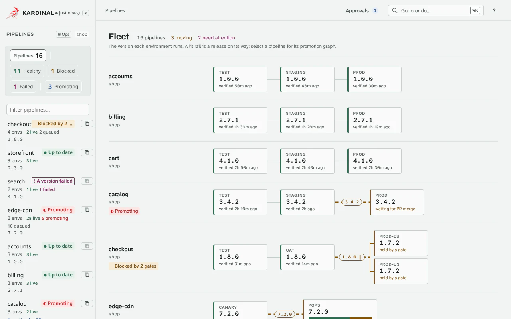

# Design a pipeline

A Pipeline is the promotion path of one application: which Git repository holds the manifests,
which environments exist and in what order they promote, and how each environment is verified.
This page shows how to shape it. Every field is listed in the
[Pipeline field reference](reference/pipeline.md).

## Large Pipelines

Each version is promoted by one kro Graph, and a Graph is one Kubernetes object, which etcd stores
only up to 1.5 MiB. Two Graph shapes keep it in bounds:

- **nodes** (Pipelines with up to 100 environments): one Graph node per environment. `kubectl get
  graph -o yaml` shows each environment's PromotionStep as a node.
- **compact** (above 100 environments): the promotion order is data in the Graph, and one node
  creates every PromotionStep the order allows (upstream environments Verified, gates ready, the
  version not superseded, rejected or waiting for a `maxConcurrentPromotions` slot). A step that exists is not removed when a gate later closes or
  the version is superseded. The Graph has about a dozen nodes whatever the number of environments,
  and no health ref nodes (health is checked by the PromotionStep as in the nodes shape).

Both shapes promote the same way: the same PromotionSteps, gate instances and PRStatuses,
with the same names. Choose one for a Pipeline with the annotation `kardinal.io/graph-shape:
compact` or `nodes`; the controller's `--graph-compact-above` (chart `graph.compactAbove`) moves
the threshold. A version keeps the shape its Graph was created with: a later Pipeline edit, a changed
annotation or threshold applies to new versions only, because switching the shape of a Graph in
flight would delete its PromotionSteps. The shape is read from the Graph's nodes; the Graph's
`kardinal.io/graph-shape` label only shows it.

In the compact shape every PromotionStep comes from one collection, so a gate instance or a
PromotionStep that kro cannot apply holds every environment of the version, not only its own (the
version's `GatesCreated` condition names a gate that cannot be created). A feature the compact shape
does not carry yet fails the version with `GraphBuildFailed` naming the feature, and sets the
Pipeline `Ready=False` while its new versions would get a compact Graph. Per-promotion MetricChecks
(`spec.perPromotion`) are carried: the `MetricChecks` collection creates an environment's instances
once its upstream environments are Verified, as the nodes shape does. One difference in pruning: if
an upstream leaves Verified before the environment's step starts, the compact shape deletes that
environment's instances (they leave the collection, so kro prunes them) and creates them again once
the upstreams are Verified; once the step has started, its instances are kept. Approval gates
(`spec.approval`, or an expression that reads `approvals.*`) are carried too: their instances come
from the `ApprovalGates` collection, and an environment is admitted only once they are ready. The
gate mirror of a `pr-review` environment (the `kardinal/gates` commit status) works the same way:
the `GateMirror` patch collection writes `spec.live.gates` onto the step by its name.
[Hooks](hooks.md) and [analysis](analysis.md) are carried too. HookRuns and AnalysisRuns are
collections created under the conditions the node shape gates them on, even once the
environment's step exists: see [Hooks](hooks.md) for the list. A run is kept once kro has
created it for this version. A run that kro cannot create holds only its own environment, and
the version's `RunsCreated` condition names it.
So is [image verification](image-verification.md): the root steps and their pre hooks wait for
the version's ImageVerification.
So are [rendered manifests](rendered-manifests.md) (`layout: branch`): the `RenderRuns`
collection creates an environment's RenderRun once its step asks for the render, as the node
shape does, keeps it once kro has created it for this version, and the step reads it back through
its own `spec.live.renders`. In a fleet, each target renders to its own branch,
`env/<fleet>-<target>`, once pacing starts it; a fleet environment takes no `render.branch`. A RenderRun that kro cannot create holds only its own environment (`RunsCreated`).

The Graph's size grows with environments, gates, hooks and analyses: every gate instance,
HookRun and AnalysisRun is one more object the Graph creates and tracks, and its data is in the
Graph. Measured: 300 environments with one gate each, fully promoted, 0.47 MB; 300 with three
gates each about 0.9 MB; 150 environments with a gate, a pre hook, a post hook and an analysis
each (750 objects) 0.67 MB. A version whose Graph would be
over 1.2 MB, or create more than 4,500 objects, fails with `GraphBuildFailed` and the size in the
message.

## Health Check Defaults

When the `health` field is omitted or partially specified, the controller applies defaults:

| Field | Default |
|---|---|
| `type` | `resource` (or `delivery.delegate` when set) |
| `resource.kind` | `Deployment` (the only supported kind) |
| `resource.name` | `Pipeline.metadata.name` |
| `resource.namespace` | Environment name |
| `resource.condition` | `Available` |
| `argocd.name` / `argocd.namespace` | `<pipeline>-<environment>` / `argocd` |
| `flux.name` / `flux.namespace` | `<pipeline>-<environment>` / `flux-system` |
| `argoRollouts.name` / `argoRollouts.namespace` | `Pipeline.metadata.name` / environment name |
| `flagger.name` / `flagger.namespace` | `Pipeline.metadata.name` / environment name |
| `timeout` | `10m` |

This means a minimal environment definition with no `health` field works for the common case where the Deployment name matches the Pipeline name and the namespace matches the environment name.

## Environment Ordering

Environments promote sequentially by default. Each environment depends on the one above it in the list.

```yaml
environments:
  - name: dev         # depends on nothing (first)
  - name: staging     # depends on dev
  - name: prod        # depends on staging
```

For non-linear topologies, use `dependsOn` to express parallel fan-out:

```yaml
environments:
  - name: dev
  - name: staging
  - name: prod-us
    dependsOn: [staging]     # depends on staging, parallel with prod-eu
  - name: prod-eu
    dependsOn: [staging]     # depends on staging, parallel with prod-us
```

Both `prod-us` and `prod-eu` start after staging is Verified. They run concurrently.

For converging topologies (all regions must pass before a final step):

```yaml
environments:
  - name: staging
  - name: prod-us
    dependsOn: [staging]
  - name: prod-eu
    dependsOn: [staging]
  - name: post-deploy-validation
    dependsOn: [prod-us, prod-eu]    # waits for both regions
```

### Wave Topology

For multi-region deployments with many parallel environments, `wave:` is syntactic sugar for `dependsOn`. Environments with the same wave number are promoted in parallel. Each wave environment automatically depends on **all** environments of the next lower wave.

```yaml
environments:
  - name: test        # no wave — sequential (depends on nothing)
  - name: staging     # no wave — sequential (depends on test)

  # Wave 1: prod-eu and prod-us start simultaneously after staging
  - name: prod-eu
    wave: 1
    approval: pr-review
    bake:
      minutes: 720

  - name: prod-us
    wave: 1
    approval: pr-review
    bake:
      minutes: 720

  # Wave 2: prod-ap starts after BOTH prod-eu AND prod-us reach Verified
  - name: prod-ap
    wave: 2
    approval: pr-review
    bake:
      minutes: 480
```

The rules, in full:

- **Previous wave.** A wave environment depends on every environment of the next lower wave that exists. Numbers need not be consecutive: with waves 10, 20 and 30, wave 20 follows wave 10. A gap never makes a wave start on its own.
- **Environments before a wave.** Without `dependsOn`, the environments of a wave also depend on the last environment without a wave listed before the wave's first environment. In the example, that is why wave 1 waits for `staging`.
- **Environments after a wave.** Without `dependsOn`, an environment without a wave depends on the environment listed before it. If that environment is in a wave, it depends on every environment of that wave.
- **`dependsOn`.** Explicit `dependsOn` entries are added to the previous-wave edges; they replace only the list-order edges.

Only the first environment in the list is a root, unless `dependsOn` says otherwise.

List the waves in ascending order. If a higher wave comes before a lower one with an environment without a wave between them (`test`, `a` in wave 2, `staging`, `b` in wave 1), the list-order edges and the wave edges form a cycle. The Pipeline is then `Ready=False` (reason `ValidationFailed`), `kardinal validate` fails, and every version fails; the message names each edge in the cycle.

See `examples/wave-topology/pipeline.yaml` for a complete example.

### Fleets

A **fleet** environment promotes the same release to many targets, such as clusters, regions or
tenants, a few at a time. Each target becomes an environment of its own, named
`<environment>-<target>`. It has its own PromotionStep, PR, gate instances and health check,
and the steps carry the label `kardinal.io/fleet: <environment>`.

<figure class="k-demo" id="demo-fleet">
  <picture>
    <source media="(prefers-reduced-motion: reduce) and (prefers-color-scheme: dark)" srcset="../assets/demos/fleet-dark.png">
    <source media="(prefers-reduced-motion: reduce)" srcset="../assets/demos/fleet.png">
    <source media="(prefers-color-scheme: dark)" srcset="../assets/demos/fleet-dark.webp">
    
  </picture>
  <figcaption>A big fleet: zoom levels and the minimap</figcaption>
</figure>


```yaml
environments:
  - name: staging
  - name: prod
    approval: auto
    fleet:
      maxConcurrent: 5      # at most 5 targets in flight
      maxUnavailable: 2     # 2 failed targets stop the rollout
      targets:
        - name: eu-west     # environment prod-eu-west, path environments/prod/eu-west
          labels: {region: eu}
        - name: us-east
          path: clusters/us-east/apps   # its own directory
          health:                       # its own health check
            type: argocd
            argocd: {name: us-east-apps}
  - name: audit             # waits for every target of prod
```

| Field | Required | Default | Description |
|---|---|---|---|
| `fleet.targets[]` | One of `targets` and `selector` | | The targets, in the order they are promoted (at most 500). `name` is a DNS label. With the environment's name and a `-`, it must make a DNS label of at most 63 characters, and it must not be the name of another environment. `labels` describe the target for a `Target` selector. `path` defaults to the environment's `path` (default `environments/<environment>`) followed by `/<name>`. `health` replaces the environment's health check for this target. |
| `fleet.selector.kind` | No | `Application` | `Target`: pick from `fleet.targets` by their `labels`, in their order. `Application`: every Argo CD Application the selector matches in `selector.namespace` is a target, named after the Application. The namespace must be one of the controller's `fleets.applicationNamespaces` (`--fleet-application-namespaces`, default `argocd`), and defaults to the first of them. The Application's `spec.source.path` is its path, and the Application is its `argocd` health check. `ClusterProfile`: every `multicluster.x-k8s.io/v1alpha1` ClusterProfile of the [cluster inventory](https://github.com/kubernetes-sigs/cluster-inventory-api) the selector matches in `selector.namespace` is a target, named after the cluster. The namespace defaults to the Pipeline's, and another one must be in the controller's `fleets.clusterProfileNamespaces`. It uses the fleet's path and health check. |
| `fleet.selector.matchLabels`, `fleet.selector.matchExpressions` | One of them | | A Kubernetes label selector (`In`, `NotIn`, `Exists`, `DoesNotExist`). |
| `fleet.maxConcurrent` | No | `0` | Targets promoted at once. A target is in flight from the creation of its PromotionStep until it is Verified. A Failed target keeps its place, so failures slow the rollout down. `0` promotes every target at once. |
| `fleet.maxUnavailable` | No | (unset) | Once this many targets have failed (`Failed`, `AbortedByAlarm` or `RollingBack`), no further target starts. The targets in flight finish. A failed target that is retried to Verified gives its place back, and the rollout goes on. Unset, failures only keep their places. |

How a fleet is promoted:

- **Order and pacing.** The targets start in their order: list order, or sorted by name for an
  `Application` or `ClusterProfile` selector. A target starts once the environments the fleet
  depends on are Verified, its own gates are ready and the fleet has a free place. A target is
  known by its name: renaming one (or its Application) removes a target and adds another, and
  the new one is promoted.
- **Gates.** A gate that applies to the fleet environment (`kardinal.io/applies-to: prod`)
  applies to each target, which gets its own instance. A gate can also name one target
  (`prod-eu-west`). A per-promotion MetricCheck that such a gate reads gets one instance per
  target. Each instance starts once the fleet's upstreams are Verified. An approval gate is
  approved per target: `kardinal approve <bundle> --env prod-eu-west`. In a `pr-review` fleet,
  each target's PR carries the `kardinal/gates` check for its own gate instances.
- **After the fleet.** An environment that depends on the fleet waits for every target to be
  Verified. A failed target holds it until that target is Verified. With `maxUnavailable` unset,
  the version is `Failed` while the other targets keep promoting. A fleet that depends on
  another fleet waits for all of it: each of its N targets lists the M targets of the first as
  upstreams, so the Graph carries N×M upstream entries (50×50 is 2,500), which count toward its
  size limit.
- **A target rolled back on its own.** `kardinal rollback --env <fleet>-<target>` rolls one
  target back without stopping the fleet's version. If the rollback pushes to that target before
  the fleet's version does, the fleet's step there does not push over it and ends `Superseded`.
  That target is settled: it frees its `maxConcurrent` place, it is neither Verified nor a
  failure (it does not count toward `maxUnavailable`), an environment after the fleet waits only
  for the other targets, and the version is Verified once they are. A fleet needs at least one
  Verified target: when every target is `Superseded`, newer versions replaced this one there, the
  environments after the fleet do not start, and the version ends `Superseded`.
- **Selector membership.** The controller resolves an `Application` or `ClusterProfile` selector
  into the Pipeline's `status.fleets`, and reads it again every minute. An Application qualifies
  only if it deploys from the Pipeline's `spec.git.url` and has a `spec.source.path`, and any
  object needs a name that can be a target. Selected objects that do not qualify are skipped and
  named in `status.fleets[].message`; the others are the targets. When the selector cannot be read
  (an API error, the CRD not served, a namespace the controller does not read), the fleet keeps
  the targets it resolved to last and the message says why, so a version in flight goes on; a fleet
  that never resolved has no targets, and its versions fail with `GraphBuildFailed`. A selector
  that matches more than 500 objects is refused the same way, without saying how many. The
  controller reads ClusterProfiles with the `get` and `list` the chart grants. Argo CD
  Applications are covered by the controller's existing read access.
- **Unresolved environments.** A step whose environment the Pipeline does not resolve to (a
  fleet target whose selector has not resolved yet or that left the fleet, or the step of an
  environment that became a fleet while it promoted) never runs with a default environment: it
  stays in its state, says why in its message, and looks again every 30 seconds.
- **Checks.** While a fleet cannot be built, the Pipeline is `Ready=False` with reason
  `ValidationFailed` and the reason in its message: no targets, a selector that cannot be
  resolved, or a target name that does not make a DNS label or is already used.
  `kardinal validate` checks static targets. For an `Application` or `ClusterProfile`
  selector it cannot read the cluster, so it checks the rest of the Pipeline with a
  stand-in target and prints a warning.
- **Targets changed mid-rollout.** An edit to `fleet.targets`, or a change in what a selector
  selects, updates the Graph of a version in flight in place. An added target takes its place in
  the target order (its list position, or its name for a selector), not the end of the queue:
  it can start before targets that were already waiting. A removed target's PromotionStep is deleted: an open PR is closed and its
  branch deleted, and a Verified target's change stays in git. Its step's record (state,
  message, PR) is kept in the Bundle's `status.retiredSteps`. Targets already Verified are not
  promoted again.
- **Rollback.** `kardinal rollback <pipeline> --env <fleet>-<target>` rolls one target back.
  Its rollback version does not supersede the fleet's version, which goes on promoting the other
  targets. Add `--hold` to keep the fleet's version (and later ones) off that target until
  `kardinal unhold`. `kardinal rollback <pipeline> --env <fleet>` rolls the whole fleet
  back. When every target that has something deployed runs the same version, the version to go
  back to is chosen as for that version, and one rollback version promotes it to every target;
  targets that already run it are Verified at once. When the targets run different versions (a
  rollout part way, or a target rolled back alone), the rollback is refused and the message
  lists what each target runs: name the version to go back to with `--to`, or roll back targets
  one by one. `--hold` on a fleet holds every target, and `kardinal unhold
  --env <fleet>` releases them. A target held through its fleet cannot be released alone.
- **Targets on one branch.** Targets in flight together push to the same branch. Argo CD (or
  Flux) can then deploy a later commit, another target's, before the target's own commit. The
  `argocd` and `flux` health checks accept a later commit only when the workloads run the
  version images ([Health Adapters](health-adapters.md)). A target whose manifests run none of
  the version images, such as a config version or a directory of ConfigMaps, can wait for its own
  commit until `health.timeout`. For such targets use `maxConcurrent: 1`, or `resource` health.
  Each target writes its own path, and every target path counts for the Pipeline's
  `PathConflict` condition.
- **Intent.** `intent.targetEnvironment` may name the fleet: the version stops after every
  target. `intent.skipEnvironments` cannot name a fleet or a target.
- **Graph shape.** A Pipeline with a fleet always uses the compact Graph shape (see
  [Large Pipelines](#large-pipelines)). Every target counts toward the environment and Graph
  size limits. The annotation `kardinal.io/graph-shape: nodes` is refused on it, and a version
  whose Graph already has the nodes shape fails if a fleet is added to its Pipeline. The fleet
  applies to new versions. Hooks, image verification and `verification` AnalysisTemplates work
  with a fleet. Each target runs the fleet's hooks and analyses. A pre hook runs only once
  pacing has admitted the target's step, so no migration runs for a target still waiting for a
  place. Post hooks and analyses start when the target's step enters Verifying.
- **CLI and UI.** `kardinal get pipelines` shows a fleet as one column, `Verified` or
  `12/50 Verified, 1 Failed, 1 Superseded (prod-eu-west)`. `kardinal status`, `promote` and `rollback` take a target's
  environment name (`prod-eu-west`). The UI's fleet board draws the fleet as one station with
  a bar of its targets: Verified, in flight, Failed and Superseded, naming the Superseded ones. It names the fleet as `stopped` once
  `maxUnavailable` is reached.

## Git Layout: Directory vs Branch

**Directory layout** (default, recommended for small teams): all environments share one branch. Each environment is a directory.

```
main branch:
  environments/
    dev/
      kustomization.yaml
    staging/
      kustomization.yaml
    prod/
      kustomization.yaml
```

Promotion updates the image tag in the target directory and pushes (auto) or opens a PR (pr-review) against the base branch.

**Branch layout** (`layout: branch`): the DRY source (Kustomize overlays or Helm charts) lives on
`spec.git.branch`, and kardinal renders each environment's path at promotion time and commits the
plain YAML to the environment's rendered branch (`render.branch`, default `env/<name>`), which
Argo CD or Flux syncs. A `pr-review` PR targets the rendered branch, so its diff is the rendered
YAML. See [Rendered Manifests](rendered-manifests.md).

### Many Pipelines on one repository and branch

Several Pipelines (and every environment of one Pipeline) can write the same repository
and branch at once, as long as each environment has its own `path`. kardinal never
force-pushes the base branch, so no writer's commit is lost:

- **auto environments**: when `git-push` finds that the branch moved since its clone
  (another writer pushed first), it fetches the new head and replays its commit onto it:
  every file this promotion added, changed or deleted takes the promotion's version, every
  other file the new head's. It pushes again, up to 6 times, without waiting in between. The
  step message then reads
  `pushed main after rebasing onto N newer commit(s) of other writers`. When the new commits
  changed one of the same files, the branch keeps moving, or the shallow clone lacks the
  commit the promotion was made on (seen with many writers on one branch), the whole step
  sequence runs again from a fresh clone (at most 3 times in one reconcile), so the update is computed on
  the other writer's version. After that the step is retried with jittered backoff (at most
  2 minutes), counted in `status.contendedRetries` with no limit and not in
  `status.retryCount`, so contention slows a promotion down but does not fail it.
  A missing base commit is the exception. `git-push` first fetches the last 200 commits of
  the branch to find it. Each fresh clone it still needs is counted in
  `status.outputs.baseMissingRestarts`. After 5 of them the step fails, because the branch was
  probably force-pushed or rewritten.
- **pr-review environments**: each promotion pushes its own branch
  `kardinal/<namespace hash>/<bundle>/<environment>` (the hash is the first 8 hex digits of
  the SHA-256 of the namespace, so versions of the same name in two namespaces get separate
  branches). The branch starts at the base head of its clone. While the PR waits for its merge,
  the controller reads the base head every 30 seconds (one `git ls-remote` per repository,
  shared by every waiting PR). When the base moved, it reads the commits since the PR's base
  (the last 20 of the branch, or the last 500 when the PR's base is further back; once per new
  head) and:
  - when they changed none of the PR's paths (the environment's `path`, and a Helm `valuesFile`
    outside it), the PR still merges cleanly: only `status.outputs.baseSHA` moves, nothing is
    pushed;
  - when they changed one of its paths, or the whole branch was read and the PR's base is not
    in it (a force-push), it reruns the promotion's steps on a fresh clone of the new head and
    force-pushes the PR branch, so the PR is one commit on the current base
    (`status.outputs.prBranchRebuilds` counts it; after a force-push the step message says so).
    If the new head already has the promotion's change, nothing is pushed and nothing is counted:
    only `baseSHA` moves. That happens when the PR merged before its status said so;
  - when the history cannot be read (an error, a read longer than 30 seconds, or a PR base
    further back than the last 500 commits), nothing is decided: the PR branch is kept as it
    is, the step message says why, and the next check reads again. Rebuilding on uncertainty
    would churn the PR and can dismiss its reviews;
  - when the PR branch has a commit kardinal did not push (its head is not
    `status.outputs.pushedSHA`), it is never rebuilt, and the step message says so.

  A rebuild replaces only kardinal's own commit; a host set to dismiss stale approvals asks for
  the review again. PRs of different Pipelines change different paths, so
  each merges without a conflict however many merged before it.
- **Path isolation**: two environments that write the same path, or one inside the other,
  overwrite each other's files and their PRs conflict. The Pipeline reconciler checks every
  Pipeline the controller sees, including two environments of one Pipeline. A Pipeline writes
  each environment's `path` and, for `update.strategy: helm`, a `valuesFile` outside it (such
  as `../shared/values.yaml`). Repositories are compared by host and path, so the https, ssh
  and `git@host:org/repo` URLs of one repository match (case, userinfo, port and a trailing
  `.git` are ignored); branches must be equal. On an overlap the Pipeline gets
  `PathConflict=True` (reason `OverlappingPath`). The message names the environments and the
  Pipelines of the same namespace; Pipelines of other namespaces are only counted
  (`environment prod (apps/prod) and 2 other Pipeline(s) in other namespaces`). It does not
  stop promotions. Environments with `update.strategy: argocd` write no git and are not
  compared.

```bash
kubectl get pipelines -A -o jsonpath='{range .items[*]}{.metadata.namespace}/{.metadata.name}: {.status.conditions[?(@.type=="PathConflict")].message}{"\n"}{end}'
```

## Promotion Steps

Every environment runs a fixed step sequence. The controller picks it from the version type,
`update.strategy`, `approval` and `layout` (`pkg/steps/defaults.go`) when the environment's step
starts, records it in the step's `status.steps`, and runs that list to the end: an `approval`
edit made while the step runs applies from the next version. The version in flight still
finishes, and its Graph turns Ready once its steps are Verified and its gates pass, with or without a PR.

| Case | Steps |
|---|---|
| Image version, `update.strategy: kustomize` (default) | `git-clone`, `kustomize-set-image`, `git-commit`, `git-push`, [`open-pr`, `wait-for-merge`,] `health-check` |
| Image version, `update.strategy: helm` | `git-clone`, `helm-set-image`, `git-commit`, `git-push`, [`open-pr`, `wait-for-merge`,] `health-check` |
| Config version | `git-clone`, `config-merge`, `git-commit`, `git-push`, [`open-pr`, `wait-for-merge`,] `health-check` |
| Mixed version | `git-clone`, `config-merge`, then the image version's update step (`kustomize-set-image`, `helm-set-image` or `yaml-update`), `git-commit`, `git-push`, [`open-pr`, `wait-for-merge`,] `health-check` |
| Image version, `update.strategy: yaml` | `git-clone`, `yaml-update`, `git-commit`, `git-push`, [`open-pr`, `wait-for-merge`,] `health-check` |
| `layout: branch` | `render` (waits for the environment's RenderRun, a Job that runs `git-clone`, the image update step (none for a config version), `render-manifests`, `git-commit` and `git-push`), [`open-pr`, `wait-for-merge`,] `health-check` |
| `update.strategy: argocd` | `argocd-set-image`, `health-check` |

`open-pr` and `wait-for-merge` run only with `approval: pr-review`. When the files in git
already have the version's change, `git-commit` finds nothing to commit: `git-push`, `open-pr`
and `wait-for-merge` then do nothing, no PR is opened, and the step goes on to the health check.
[Architecture: Steps Engine](architecture.md#steps-engine-pkgsteps)
describes each step.

kardinal has no custom step engine: nothing in a Pipeline changes the sequence. To run your own
work around the sequence, use [hooks](hooks.md): Jobs before the step starts and after its
health check.

### How `kustomize-set-image` matches images

kustomize matches an `images` entry on its `name` only, against the image name in the
manifests. So `kustomize-set-image` always writes, or updates, an entry whose `name` is the
full repository (for example `name: ghcr.io/org/app`), as `kustomize edit set image` does.
That entry rewrites manifests that use `image: ghcr.io/org/app`.

Entries that point at the repository under another name get the same tag or digest, so
manifests that use that name keep promoting:

- an entry whose `newName` is the repository (for example `name: app`,
  `newName: ghcr.io/org/app`, as older kardinal versions wrote it);
- an older short-name entry (`name: app`, no `newName`), when only one version image has that
  short name. It also gets `newName: ghcr.io/org/app`.

A short-name entry whose `newName` points at another repository is left alone.

### The yaml update strategy

`update.strategy: yaml` writes values of the version's images into any YAML paths of any files
in the environment directory: plain manifests, Helm values, a Kustomize `images` entry, a
custom resource. Each `update.yaml.updates[]` entry sets one scalar:

```yaml
update:
  strategy: yaml
  yaml:
    updates:
      - file: deploy/deployment.yaml
        path: spec.template.spec.containers[0].image
        image: ghcr.io/org/api           # which Bundle image; optional with one image
        value: image                     # ghcr.io/org/api:1.4.2
      - file: deploy/deployment.yaml
        path: spec.template.spec.containers[1].image
        image: ghcr.io/org/sidecar
        value: imageWithDigest           # ghcr.io/org/sidecar:0.3.0@sha256:...
      - file: values.yaml
        path: api.image.tag
        image: ghcr.io/org/api           # value defaults to tag: 1.4.2
```

| `value` | Written |
|---|---|
| `tag` (default) | the tag |
| `digest` | the digest (`sha256:...`) |
| `tagWithDigest` | `<tag>@<digest>` |
| `image` | `<repository>:<tag>` |
| `imageWithDigest` | `<repository>:<tag>@<digest>`, or `<repository>@<digest>` without a tag |

- `path` uses the [YAML path](#yaml-paths) grammar, as `update.helm.chartVersionPath` does.
  Missing mapping keys are created; list elements are not.
- The step computes every edit before it writes anything. An edit that cannot be applied (a
  version without the named image, a value the image does not have such as the digest of a
  tag-only image, a missing list element, a path through a scalar, a path that would replace a
  mapping or list, a file outside the repository) fails the step for good and no file is
  changed.
- Comments, key order, the quoting of the replaced value and the file mode are kept. Every edited
  file is parsed again before it is written and must still hold every value where it was set. The
  files are then written through new temporary files (never through a file or link already at that
  name) and renamed; if a rename fails, the files already replaced get their old content back.
- Refused, failing the step: a file with more than one YAML document (`---`; an empty or
  comment-only document after the first, such as a trailing `---` or `--- # end`, is not written
  back, and its comments move to the end of the file), an anchor or alias
  (`&`, `*`) or a merge key (`<<`) on the edited path, a key that appears twice in one mapping, a
  symbolic link anywhere on the path (the environment directory, a directory in `file`, or the
  file), a file over 4 MiB, and a `file` that is absolute or contains `..`.
- A version without images (a config version) changes nothing.

### YAML paths

`update.yaml.updates[].path` and `update.helm.chartVersionPath` name a scalar in a YAML file
with one grammar:

- Keys separated by `.`; a leading `.` is optional (`image.tag` and `.image.tag` are the same).
  A key is letters, digits, `_` and `-`. A key that contains `.` or `/` (an annotation such as
  `app.kubernetes.io/version`) cannot be addressed.
- `[N]` after a key picks a list element by position: `spec.template.spec.containers[0].image`.
  A digits-only key does the same when it reaches a list (`.dependencies.0.version`); in a
  mapping it is a key. An index has at most 9 digits.
- `[field=value]` picks the list element (a mapping) whose `field` has that value:
  `spec.template.spec.containers[name=app].image`, `.dependencies[name=podinfo].version`. The
  value is letters, digits and `_ - . / : @`.
- The element a list step names must exist, and so must the list: a missing or null value before
  `[N]`, `[field=value]` or a digits-only key fails the step for good instead of being created
  as a mapping.

The API server checks the grammar: a Pipeline with a path outside it is refused.

### Image signatures and tests

Checks that must hold for the running workload belong where it runs, not in the promoter:

- **Image signatures.** `spec.imageVerification` verifies cosign and Sigstore signatures
  before a version is promoted ([Image Signature Verification](image-verification.md)). Also
  enforce them at admission in the cluster that runs the pods, with
  [Sigstore policy-controller](https://docs.sigstore.dev/policy-controller/overview/) or
  [Kyverno `verifyImages`](https://kyverno.io/docs/policy-types/cluster-policy/verify-images/):
  a check in the promoter is bypassed by anyone who can push to the GitOps repository;
  admission is not.
- **Tests after a deploy.** Run them as a [post-deploy hook](hooks.md): a Job kardinal runs
  after the health check passed; the environment is Verified only when it succeeded. Or run
  them as an Argo CD
  [PostSync hook](https://argo-cd.readthedocs.io/en/stable/user-guide/sync-waves/) Job and
  set `health.type: argocd`. Argo CD keeps the sync operation open while the hook runs and
  marks it failed when a PostSync hook fails. The argocd adapter is healthy only when the
  Application is Healthy and Synced on the promoted revision and its last operation is
  `Succeeded` (or there is none), so the step waits for the tests; a `Failed` or `Error`
  operation on that revision is a health failure and applies `onHealthFailure`.
- **Analysis.** Name Argo Rollouts AnalysisTemplates in `verification` (any Rollouts
  provider: Prometheus, Datadog, CloudWatch, New Relic, web, Job); see [Analysis](analysis.md).
- **Metric checks.** Create a `MetricCheck` and read it from a gate on the next
  environment, for example `metrics["error-rate"].result == "Pass"`. See
  [Policy Gates: Metric-based](policy-gates.md#metric-based).

## Examples

### Minimal (all defaults)

[examples/minimal/pipeline.yaml](https://github.com/pnz1990/kardinal-promoter/blob/main/examples/minimal/pipeline.yaml), 12 lines:

```yaml
apiVersion: kardinal.io/v1alpha1
kind: Pipeline
metadata: { name: my-app }
spec:
  git:
    url: https://github.com/myorg/gitops
    secretRef: { name: github-token }
  environments:
    - name: test
    - name: uat
    - name: prod
      approval: pr-review
```

Each environment follows the one before it, lives at `environments/<name>` on `main`, is
updated with kustomize and promotes on its own, except prod, whose PR waits for a merge. The
health check waits for Deployment `my-app` in the namespace of the environment's name to be
Available (see [Health Check Defaults](#health-check-defaults)).

### Multi-cluster with Argo Rollouts

The `argocd` checks work for any destination cluster because the Applications live in the controller's cluster. The `argoRollouts` checks read the Rollout in the controller's cluster, so this layout suits Rollouts that the controller's cluster runs: here each prod region has its own namespace there. Give each environment its own Rollout; two environments that name the same one check the same object. For Rollouts in other clusters, check their hub Applications with `type: argocd` instead (see [Remote Clusters](health-adapters.md#remote-clusters)).

```yaml
apiVersion: kardinal.io/v1alpha1
kind: Pipeline
metadata:
  name: my-app
spec:
  git:
    url: https://github.com/myorg/gitops-repo
    secretRef: { name: github-token }
  environments:
    - name: test
      approval: auto
      health:
        type: argocd
        argocd: { name: my-app-test }
    - name: pre-prod
      approval: pr-review
      health:
        type: argocd
        argocd: { name: my-app-pre-prod }
    - name: prod-us
      dependsOn: [pre-prod]
      approval: pr-review
      health:
        type: argoRollouts
        argoRollouts: { name: my-app, namespace: prod-us }
      delivery:
        delegate: argoRollouts
    - name: prod-eu
      dependsOn: [pre-prod]
      approval: pr-review
      health:
        type: argoRollouts
        argoRollouts: { name: my-app, namespace: prod-eu }
      delivery:
        delegate: argoRollouts
```

### Remote prod cluster through an Argo CD hub

Health adapters read objects in the controller's own cluster unless `health.kubeconfigSecretRef` names a kubeconfig Secret for another cluster; then every health type, including a Rollout, Canary or Deployment, reads its object there. Without a kubeconfig, let an Argo CD instance in the controller's cluster manage the workload and check its Application there: the adapter confirms the Application synced the promoted commit and is Healthy. A Flux Kustomization in the hub that targets the cluster with `spec.kubeConfig.secretRef` works the same way with `type: flux`. The deprecated `health.cluster` string is not supported. See [Health Adapters](health-adapters.md#remote-clusters).

```yaml
apiVersion: kardinal.io/v1alpha1
kind: Pipeline
metadata:
  name: my-app
spec:
  git:
    url: https://github.com/myorg/gitops-repo
    secretRef: { name: github-token }
  environments:
    - name: dev
      health:
        type: flux
        flux: { name: my-app-dev, namespace: flux-system }
    - name: prod
      approval: pr-review
      health:
        type: argocd
        argocd: { name: my-app-prod, namespace: argocd }   # Application in the hub, destination: the prod cluster
```

### Rendered manifests (branch layout)

`examples/rendered-manifests/pipeline.yaml`: every environment renders its overlay into
`env/<name>`, prod through a PR. See [Rendered Manifests](rendered-manifests.md).
