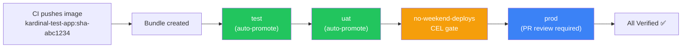

# Quickstart

This guide walks you through setting up your first promotion pipeline with kardinal-promoter. By the end, you will have a working pipeline that promotes the `kardinal-test-app` through test, uat, and prod environments using Git pull requests.

## One command: `kardinal quickstart`

On a local cluster (kind, k3d, minikube, Docker Desktop or Rancher Desktop),
`kardinal quickstart` installs everything and promotes a first version. You
need `helm`, `kubectl`, a fork of
[`pnz1990/kardinal-demo`](https://github.com/pnz1990/kardinal-demo), and a
GitHub token with **contents** and **pull requests** read and write on the
fork: `GITHUB_TOKEN`, or the token of `gh auth login`.

```bash
gh repo fork pnz1990/kardinal-demo --clone=false
kind create cluster --name kardinal
kardinal quickstart --repo https://github.com/<you>/kardinal-demo
```

```
Setting up the kardinal demo in kind-kardinal
  ✓ kro 0.10.0-rc.0: installed
  ✓ Argo CD v3.5.3: installed
  ✓ Secret kardinal-system/kardinal-scm-token: created from $GITHUB_TOKEN (the controller's token for PRs)
  ✓ kardinal-promoter 0.10.1: installed
  ✓ Secret default/github-token: created from $GITHUB_TOKEN
  ✓ Argo CD ApplicationSet argocd/kardinal-test-app (https://github.com/<you>/kardinal-demo): applied
  ✓ PolicyGate default/prod-approval (prod waits for your approval, as kubernetes-admin): applied
  ✓ Pipeline default/demo: applied
  ✓ First version: shipped as demo-7xk2p
Following version sha-9349a3f (demo-7xk2p) through test, uat and prod (Ctrl-C stops following, the promotion goes on)
  test: Checking health
  test: Live
  uat: Promoting
  uat: Checking health
  uat: Live
  prod: Held by gate prod-approval
Version sha-9349a3f (demo-7xk2p) stopped: prod waits for approval at gate prod-approval (kardinal approve demo prod)

Next:
  Approve prod:    kardinal approve demo prod
  Watch:           kardinal status demo -w
  Open the UI:     kardinal dashboard
  Ship the next:   kardinal ship demo --image ghcr.io/pnz1990/kardinal-test-app:main@sha256:51a7355fc6cb8928c89cef5bdf55a7e1ea9fe8be102beb718486338fc7286cd0 --wait
```

The indented state lines go to stderr; the rest goes to stdout. What it does, each step only
when it is not done yet:

- It refuses any kubeconfig context that is not a local cluster (by name: `kind-*`, `k3d-*`,
  `minikube`, `docker-desktop`, `rancher-desktop`; and by API server: this machine, or for
  minikube a private address) before it sends anything to it. There is no flag to override that. It
  never changes your kubeconfig; `--context` picks another local context.
- It installs kro (the version `hack/install-kro.sh` pins), Argo CD, and the kardinal-promoter
  chart in `kardinal-system` (`--chart-version` and `--set` change it; `--no-argocd` skips
  Argo CD when the cluster has one).
- It creates in `default`, so no command needs `-n`:
  - the Pipeline's git Secret `github-token`;
  - an Argo CD ApplicationSet that deploys `environments/<env>` of your fork as the
    Applications `kardinal-test-app-<env>`;
  - a PolicyGate `prod-approval`: prod waits for your approval, and only yours (the user
    the cluster says you are);
  - the Pipeline `demo`: test, uat and prod, all `approval: auto`, with prod behind the
    gate and health checked through the Applications.
- It ships the first version, then follows it until prod waits for you.

`kardinal approve demo prod` ships the version to prod. `kardinal dashboard` port-forwards to
the controller and opens the UI. A held stage there shows the same `kardinal approve demo prod`
command with a copy button: the quickstart UI does not authenticate you, so it cannot record
an approval for you. Running `kardinal quickstart` again changes nothing.

To get a pull request with evidence for prod, as in the full setup below, set prod's
`approval: pr-review` in the Pipeline (`kubectl edit pipeline demo`). The next version then
waits for your approval at prod, opens a PR on your fork with the promotion evidence, and is
live in prod once you merge it.

## Fast Start — under 10 minutes

Install with `demo.enabled=true` and you get a pre-configured
Pipeline named `demo` in the release namespace. It pushes to the repository in
`demo.git.url`, which defaults to the
[`pnz1990/kardinal-demo`](https://github.com/pnz1990/kardinal-demo) reference repository.
Your token cannot write to that repository, so fork it first and set `demo.git.url` to the fork.

Before you start, the cluster needs:

- kro with the `GraphKind` feature gate (step 1 below).
- Argo CD with one Application per environment: `kardinal-test-app-test`, `kardinal-test-app-uat`
  and `kardinal-test-app-prod` in the `argocd` namespace. The demo Pipeline checks health
  through them. Create them with the ApplicationSet in
  [Create Argo CD Applications](#create-argo-cd-applications).

```bash
# 0. Fork the demo GitOps repo (your GITHUB_PAT needs write access to the fork)
gh repo fork pnz1990/kardinal-demo --clone=false
DEMO_REPO=https://github.com/<your-user>/kardinal-demo

# 1. Install kro (from a kardinal-promoter checkout)
bash hack/install-kro.sh

# 2. Store the token in two Secrets: the controller's (never labelled, no
#    Pipeline may use it) and the demo Pipeline's own git Secret, labelled so
#    a Pipeline may name it. Then install with demo mode.
kubectl create namespace kardinal-system
kubectl create secret generic scm-token \
  --namespace kardinal-system \
  --from-literal=token=$GITHUB_PAT
kubectl create secret generic demo-git-token \
  --namespace kardinal-system \
  --from-literal=token=$GITHUB_PAT
kubectl label secret demo-git-token --namespace kardinal-system kardinal.io/referenceable=true

helm install kardinal-promoter oci://ghcr.io/pnz1990/charts/kardinal-promoter --version 0.10.0 \
  --namespace kardinal-system \
  --set demo.enabled=true \
  --set demo.git.url=$DEMO_REPO \
  --set scm.secretRef.name=scm-token \
  --set demo.secretRef.name=demo-git-token

# 3. Check the demo Pipeline (it lives in the release namespace)
kardinal get pipelines -n kardinal-system
# PIPELINE   BUNDLE   TEST   UAT   PROD   SUB   AGE
# demo       -        -      -     -      0     10s

# 4. Trigger the first promotion. The kardinal-demo overlays already run
#    sha-9349a3f, so a Bundle with only that tag changes nothing; the digest
#    makes it a real change (see "Create your first Bundle" below).
kardinal create bundle demo -n kardinal-system \
  --image ghcr.io/pnz1990/kardinal-test-app:sha-9349a3f@sha256:51a7355fc6cb8928c89cef5bdf55a7e1ea9fe8be102beb718486338fc7286cd0
```

The demo Pipeline uses your fork of the `kardinal-demo` GitOps repo (it already has the
correct Kustomize layout). Test and uat environments promote automatically; prod opens a PR for review.

!!! note "Estimated time: under 10 minutes on a fresh kind cluster"
    Prerequisites: kind cluster, `helm`, `kubectl`, the `kardinal` CLI
    ([Install the CLI](installation.md#3-install-the-cli)), Argo CD, and a GitHub PAT
    with write access to the repository in `demo.git.url`. Point the ApplicationSet
    `repoURL` in [Create Argo CD Applications](#create-argo-cd-applications) at the same fork.

---

## Full Setup (bring your own GitOps repo)

Use the full guide below to set up kardinal-promoter against your own GitOps repository.

## What you will build



- Test and uat promote automatically when the upstream environment is verified.
- Prod requires a human to review and merge a PR.
- The PR includes promotion evidence: what image is being deployed, who built it, and what upstream verification looked like.

!!! info "Test application"
    This quickstart uses [`pnz1990/kardinal-test-app`](https://github.com/pnz1990/kardinal-test-app) and the [`pnz1990/kardinal-demo`](https://github.com/pnz1990/kardinal-demo) GitOps repository. These are the reference applications used in kardinal's own CI validation.

## Prerequisites

- A Kubernetes 1.30 or later cluster (kind, Docker Desktop, EKS, GKE, or any distribution)
- [kardinal-promoter installed](#install-kardinal-promoter), and the `kardinal` CLI ([Install the CLI](installation.md#3-install-the-cli))
- [Argo CD installed](https://argo-cd.readthedocs.io/en/stable/getting_started/) (or Flux; this guide uses Argo CD)
- A GitHub account with a personal access token (PAT) that has repo write access
- A GitOps repository with Kustomize overlays (see [Set Up Your GitOps Repo](#set-up-your-gitops-repo))

## Install kardinal-promoter

kardinal-promoter runs on the upstream [kro](https://github.com/kubernetes-sigs/kro) Graph controller. Install kro v0.10.0-rc.0 with the `GraphKind` feature gate first:

```bash
# From a kardinal-promoter checkout
bash hack/install-kro.sh
```

Then install kardinal-promoter:

```bash
# Option A: reference an existing Secret (recommended for production)
# The controller watches this Secret and reloads the token automatically on rotation —
# no controller restart needed. See "Credential rotation" in docs/scm-providers.md.
kubectl create namespace kardinal-system --dry-run=client -o yaml | kubectl apply -f -
kubectl create secret generic github-token \
  --namespace kardinal-system \
  --from-literal=token=$GITHUB_PAT \
  --dry-run=client -o yaml | kubectl apply -f -

helm install kardinal-promoter oci://ghcr.io/pnz1990/charts/kardinal-promoter --version 0.10.0 \
  --namespace kardinal-system --create-namespace \
  --set scm.secretRef.name=github-token

# Option B: pass the token directly (development/testing only)
# The chart stores it in Secret kardinal-promoter-github-token, but the token
# also stays in the Helm release history.
helm install kardinal-promoter oci://ghcr.io/pnz1990/charts/kardinal-promoter --version 0.10.0 \
  --namespace kardinal-system --create-namespace \
  --set scm.token=$GITHUB_PAT
```

Verify the installation:

```bash
kubectl get pods -n kardinal-system
# NAME                                              READY   STATUS    RESTARTS   AGE
# kardinal-promoter-7f8d9c5b6d-x2k9q               1/1     Running   0          30s

kubectl get pods -n kro-system
# NAME                              READY   STATUS    RESTARTS   AGE
# kro-7d4b8f9f5-xk2pq               1/1     Running   0          30s

kardinal version
# CLI:        v0.10.0
# Controller: v0.10.0
# Graph:      kro v0.10.0-rc.0
```

## Set up your GitOps repo

This quickstart uses [`pnz1990/kardinal-demo`](https://github.com/pnz1990/kardinal-demo) as the GitOps target repository. It already has one directory per environment on `main`. Fork it: kardinal pushes to this repository, so the token needs write access to it.

The repository structure:

```
environments/
  test/
    kustomization.yaml      # pins the image tag kardinal updates
    deployment.yaml         # the kardinal-test-app Deployment, in namespace default
  uat/
    kustomization.yaml
    deployment.yaml
  prod/
    kustomization.yaml
    deployment.yaml
```

## Create Argo CD Applications

Create an Argo CD ApplicationSet to manage the three environments:

```bash
cat <<EOF | kubectl apply -f -
apiVersion: argoproj.io/v1alpha1
kind: ApplicationSet
metadata:
  name: kardinal-test-app
  namespace: argocd
spec:
  generators:
    - list:
        elements:
          - env: test
          - env: uat
          - env: prod
  template:
    metadata:
      name: kardinal-test-app-{{env}}
    spec:
      project: default
      source:
        repoURL: https://github.com/pnz1990/kardinal-demo   # your fork
        targetRevision: main
        path: environments/{{env}}
        # The kardinal-demo overlays set namespace "default"; move each
        # environment into its own namespace so they do not collide.
        kustomize:
          namespace: kardinal-test-app-{{env}}
      destination:
        server: https://kubernetes.default.svc
        namespace: kardinal-test-app-{{env}}
      syncPolicy:
        automated:
          prune: true
          selfHeal: true
        syncOptions:
          - CreateNamespace=true
EOF
```

## Create the Pipeline

First, create a Secret with your GitHub token:

```bash
kubectl create secret generic github-token \
  --namespace default \
  --from-literal=token=<your-github-pat>
# A Secret a Pipeline names must be labelled referenceable (docs/guides/security.md).
kubectl label secret github-token --namespace default kardinal.io/referenceable=true
```

Write the Pipeline and apply it with `kardinal init`. It finds the Argo CD Applications above
(`kardinal-test-app-<env>` in `argocd`) and checks health with them; everything else is a default:
each environment follows the one before it, at `environments/<name>` on `main`, updated with
kustomize, and prod waits for its PR to be merged:

```bash
kardinal init --name kardinal-test-app --repo https://github.com/pnz1990/kardinal-demo \
  --envs test,uat,prod -n default --apply
# Found Argo CD Application argocd/kardinal-test-app-test: test checks health with it
# Found Argo CD Application argocd/kardinal-test-app-uat: uat checks health with it
# Found Argo CD Application argocd/kardinal-test-app-prod: prod checks health with it
# Pipeline YAML written to pipeline.yaml
# Pipeline default/kardinal-test-app created
```

Add `--create-secret` to create the git Secret of the step above from `$GITHUB_TOKEN` (or `gh auth
token`). Or apply the same Pipeline by hand, which also gives prod a longer health timeout. It is
`examples/quickstart/pipeline.yaml` (`kubectl apply -f examples/quickstart/pipeline.yaml` from a checkout) with the Application names written out:

```bash
cat <<EOF | kubectl apply -f -
apiVersion: kardinal.io/v1alpha1
kind: Pipeline
metadata:
  name: kardinal-test-app
  namespace: default
spec:
  git:
    url: https://github.com/pnz1990/kardinal-demo
    secretRef:
      name: github-token
  environments:
    - name: test
      health:
        type: argocd
        argocd:
          name: kardinal-test-app-test
    - name: uat
      health:
        type: argocd
        argocd:
          name: kardinal-test-app-uat
    - name: prod
      approval: pr-review
      health:
        type: argocd
        argocd:
          name: kardinal-test-app-prod
        timeout: 15m
EOF
```

Verify the Pipeline was created:

```bash
kardinal get pipelines
# PIPELINE            BUNDLE   TEST   UAT   PROD   SUB   AGE
# kardinal-test-app   -        -      -     -      0     10s
```

!!! tip "Troubleshooting: Pipeline not appearing"
    If the pipeline doesn't appear, check that the controller is running:
    ```bash
    kubectl get pods -n kardinal-system
    kubectl logs -n kardinal-system deployment/kardinal-promoter | tail -20
    ```

## Create your first Bundle

In a real setup, your CI pipeline creates Bundles after building and pushing images.
For this quickstart, promote the `kardinal-test-app` image `sha-9349a3f` with its digest pinned.
The kardinal-demo overlays already run `sha-9349a3f`, so a Bundle with only that tag changes nothing and opens no PR; the digest adds a `digest:` line to each overlay.

```bash
TEST_IMAGE="ghcr.io/pnz1990/kardinal-test-app:sha-9349a3f@sha256:51a7355fc6cb8928c89cef5bdf55a7e1ea9fe8be102beb718486338fc7286cd0"

# Create the Bundle
kardinal create bundle kardinal-test-app --image $TEST_IMAGE
```

Or equivalently with kubectl:

```bash
cat <<EOF | kubectl apply -f -
apiVersion: kardinal.io/v1alpha1
kind: Bundle
metadata:
  name: kardinal-test-app-sha-9349a3f
  namespace: default
  labels:
    kardinal.io/pipeline: kardinal-test-app
spec:
  type: image
  pipeline: kardinal-test-app
  images:
    - repository: ghcr.io/pnz1990/kardinal-test-app
      tag: sha-9349a3f
      digest: sha256:51a7355fc6cb8928c89cef5bdf55a7e1ea9fe8be102beb718486338fc7286cd0
  provenance:
    commitSHA: "9349a3f"
    author: "quickstart"
EOF
```

## Watch the promotion

The promotion starts immediately. kardinal-promoter generates a Graph and begins promoting through environments.

```bash
# Watch the pipeline status
kardinal get pipelines
# PIPELINE            BUNDLE                    TEST       UAT              PROD      SUB   AGE
# kardinal-test-app   kardinal-test-app-x7k2p   Live   Checking health   Not reached   0     2m

# See the steps of the active Bundle
kardinal get steps kardinal-test-app
# ENVIRONMENT   STEP           STATE        DURATION   MESSAGE
# test          git-clone      Completed    812ms      -
#               ...
# uat           git-clone      Completed    790ms      -
#               ...
#               health-check   InProgress   -          -

# Check why prod hasn't started: prod gets a PromotionStep only after uat is
# Verified (and, with gates, after every gate passes)
kardinal explain kardinal-test-app --env prod
# No promotion for "prod" in pipeline "kardinal-test-app" yet
```

!!! tip "Troubleshooting: Test stuck in Checking health"
    If the test environment stays in `HealthChecking` for more than a few minutes:
    ```bash
    kubectl get deployment kardinal-test-app -n kardinal-test-app-test
    kubectl describe application kardinal-test-app-test -n argocd
    ```
    Check that ArgoCD has synced the environment and the deployment is healthy.

Once uat is verified, the prod PromotionStep is created. Since prod uses `approval: pr-review`, kardinal-promoter opens a PR:

```bash
kardinal get steps kardinal-test-app
# ENVIRONMENT   STEP             STATE        DURATION   MESSAGE
# ...
# prod          git-clone        Completed    790ms      -
#               ...
#               wait-for-merge   InProgress   -          -
```

Go to your fork of kardinal-demo. You will see a PR titled:

> **[kardinal] Promote kardinal-test-app-x7k2p to prod**

(`kardinal create bundle` names the Bundle `<pipeline>-<random suffix>`.)

The PR body contains:
- The artifact being promoted (image reference, digest)
- Build provenance (commit SHA, CI run link, author)
- Upstream verification status (test and uat verified timestamps)
- Policy gate compliance (if any gates are configured)

**Merge the PR.** kardinal-promoter checks the PR every 30 seconds and sees the merge. With an SCM webhook set up, it sees it at once. Argo CD then syncs the prod Application, and the health adapter verifies it.

```bash
kardinal get pipelines
# PIPELINE            BUNDLE                    TEST       UAT        PROD       SUB   AGE
# kardinal-test-app   kardinal-test-app-x7k2p   Live   Live   Live   0     8m
```

The promotion is complete.

## Adding policy gates (optional)

To add a no-weekend-deploys gate to prod, create a PolicyGate in the platform-policies namespace:

```bash
kubectl create namespace platform-policies 2>/dev/null

cat <<EOF | kubectl apply -f -
apiVersion: kardinal.io/v1alpha1
kind: PolicyGate
metadata:
  name: no-weekend-deploys
  namespace: platform-policies
  labels:
    kardinal.io/scope: org
    kardinal.io/applies-to: prod
spec:
  expression: "!schedule.isWeekend"
  message: "Production deployments are blocked on weekends"
  recheckInterval: 5m
EOF
```

The next Bundle promoted to prod will have this gate injected into its Graph. If it is a weekend, the gate blocks the promotion and `kardinal explain` shows the gate with the controller's latest evaluation, the Bundle it belongs to, and the Bundle still deployed in prod:

```bash
kardinal explain kardinal-test-app --env prod
# ENVIRONMENT   BUNDLE                    TYPE         NAME                 STATE   EXPRESSION            REASON
# prod          kardinal-test-app-9tptr   PolicyGate   no-weekend-deploys   Block   !schedule.isWeekend   Production deployments are blocked on weekends (bundle.version=sha-abc1234: !schedule.isWeekend = false)
#
# prod   deployed: kardinal-test-app-7qvsr (sha-1a2b3c4)
```

## Adding to your CI pipeline

Add a step to your CI pipeline that creates a Bundle after building and pushing your image.

The Bundle API (`POST /api/v1/bundles`) listens on port 8083 of the `kardinal-promoter` Service and is off until you set `bundleAPI.tokenSecretRef.name`. Expose it to CI yourself (for example with an Ingress); `kardinal.example.com` below stands for that address. See [CI integration](ci-integration.md#webhook-token).

**GitHub Actions example:**

```yaml
- name: Create Bundle
  run: |
    curl -X POST https://kardinal.example.com/api/v1/bundles \
      -H "Authorization: Bearer ${{ secrets.KARDINAL_TOKEN }}" \
      -d '{
        "pipeline": "kardinal-test-app",
        "type": "image",
        "images": [{"repository": "ghcr.io/${{ github.repository }}", "tag": "sha-${{ github.sha }}", "digest": "${{ steps.build.outputs.digest }}"}],
        "provenance": {
          "commitSHA": "${{ github.sha }}",
          "ciRunURL": "${{ github.server_url }}/${{ github.repository }}/actions/runs/${{ github.run_id }}",
          "author": "${{ github.actor }}"
        }
      }'
```

## Next steps

- [Core Concepts](concepts.md): deeper dive into Bundles, Pipelines, PolicyGates, and health adapters
- [Multi-Cluster Fleet Example](https://github.com/pnz1990/kardinal-promoter/tree/main/examples/multi-cluster-fleet): parallel prod regions with Argo Rollouts canary
- [Architecture](architecture.md): how the controller works
