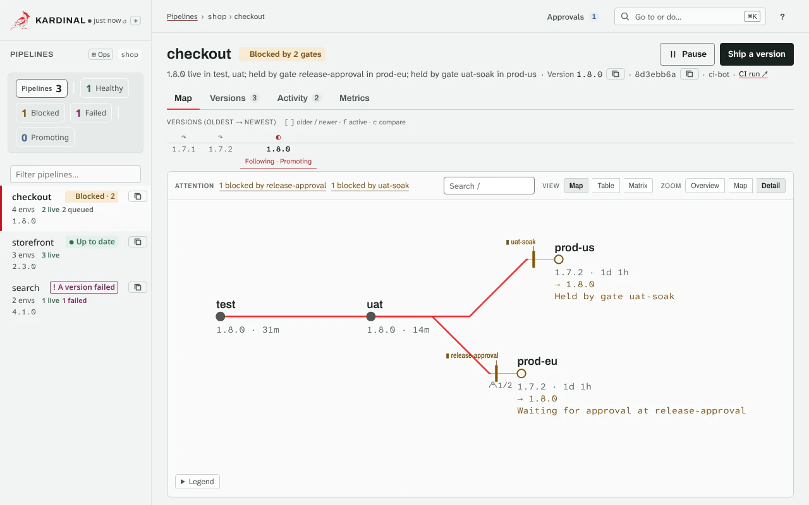

# Quickstart

This guide walks you through setting up your first promotion pipeline with kardinal-promoter. By the end, you will have a working pipeline that promotes the `kardinal-test-app` through test, uat, and prod environments using Git pull requests.

## One command: `kardinal quickstart`

On a local cluster (kind, k3d, minikube, Docker Desktop or Rancher Desktop),
`kardinal quickstart` installs everything and promotes a first version. You
need `helm`, `kubectl`, a GitHub fork of
[`pnz1990/kardinal-demo`](https://github.com/pnz1990/kardinal-demo), and a
GitHub token with **contents** and **pull requests** read and write on the
fork: `GITHUB_TOKEN`, or the token of `gh auth login`.

quickstart supports forks on github.com. A `--repo` on another git host is refused before
anything is installed; install kardinal by hand for it ([Installation](installation.md),
[SCM providers](scm-providers.md)), or pass `--set scm.provider=<provider> --set scm.apiURL=<url>`
so that quickstart installs the controller for that host.

```bash
gh repo fork pnz1990/kardinal-demo --clone=false
kind create cluster --name kardinal
kardinal quickstart --repo https://github.com/<you>/kardinal-demo
```

```
Setting up the kardinal demo in kind-kardinal
  ✓ kro 0.10.0-rc.0: installed
  ✓ Argo CD v3.5.3: installed
  ✓ Secret kardinal-system/kardinal-scm-token: created from $GITHUB_TOKEN (the controller's token for PRs)
  ✓ kardinal-promoter 0.11.0: installed
  ✓ Secret default/github-token: created from $GITHUB_TOKEN
  ✓ Argo CD ApplicationSet argocd/kardinal-test-app (https://github.com/<you>/kardinal-demo): applied
  ✓ PolicyGate default/prod-approval (prod waits for your approval, as kubernetes-admin): applied
  ✓ Pipeline default/demo: applied
  ✓ First version: shipped as demo-7xk2p
Following version sha-9349a3f (demo-7xk2p) through test, uat and prod (Ctrl-C stops following, the promotion goes on)
  test: Checking health
  test: Live
  uat: Promoting
  uat: Checking health
  uat: Live
  prod: Held by gate prod-approval
Version sha-9349a3f (demo-7xk2p) stopped: prod waits for approval at gate prod-approval (kardinal approve demo prod)

Next:
  Approve prod:    kardinal approve demo prod
  Watch:           kardinal status demo -w
  Open the UI:     kardinal dashboard
  Ship the next:   kardinal ship demo --image ghcr.io/pnz1990/kardinal-test-app:main@sha256:51a7355fc6cb8928c89cef5bdf55a7e1ea9fe8be102beb718486338fc7286cd0 --wait
```

The indented state lines go to stderr; the rest goes to stdout. What it does, each step only
when it is not done yet:

- It refuses any kubeconfig context that is not a local cluster (by name: `kind-*`, `k3d-*`,
  `minikube`, `docker-desktop`, `rancher-desktop`; and by API server: this machine, or for
  minikube its drivers' networks 192.168.49.0/24, 192.168.39.0/24 and 192.168.59.0/24) before
  it sends anything to it, and refuses to run while `HELM_KUBE*` (such as `HELM_KUBECONTEXT`) or
  `KUBERNETES_MASTER` is set, since helm or kubectl would follow them instead, or when the
  context's cluster has a `proxy-url`, or when `HTTPS_PROXY` (`HTTP_PROXY` for an `http` server)
  applies to its API server: the proxy would decide where requests go. Go never proxies
  `localhost` and `127.0.0.1`; for `0.0.0.0` (k3d), `host.docker.internal` or a minikube address,
  add the host to `NO_PROXY`. There is no flag
  to override that, on purpose. helm and kubectl run on a kubeconfig file with only the checked
  context. It never changes your kubeconfig; `--context` picks another local context. One thing
  it cannot tell: a loopback port that tunnels to a remote cluster (`kubectl port-forward`,
  `ssh -L`) looks local, so do not point a local context at such a tunnel.
- It installs kro (the version `hack/install-kro.sh` pins), Argo CD, and the kardinal-promoter
  chart in `kardinal-system` (`--chart-version` and `--set` change it; `--no-argocd` skips
  Argo CD when the cluster has one). The Argo CD it installs polls git every 10 seconds
  (`timeout.reconciliation: 10s` in `argocd-cm`, no jitter) instead of every 2 to 3 minutes,
  so each environment deploys its merged commit within seconds; an Argo CD that was already
  there keeps its settings.
- It creates in `default`, so no command needs `-n`:
  - the Pipeline's git Secret `github-token`;
  - an Argo CD ApplicationSet that deploys `environments/<env>` of your fork as the
    Applications `kardinal-test-app-<env>`;
  - a PolicyGate `prod-approval`: prod waits for your approval, and only yours (the user
    the cluster says you are);
  - the Pipeline `demo`: test, uat and prod, all `approval: auto`, with prod behind the
    gate and health checked through the Applications.
- It ships the first version, then follows it until prod waits for you.

`kardinal why demo prod` says what prod waits for and the command that moves it on:

```
prod is waiting for your approval.
  Version  sha-9349a3f (demo-7xk2p)
  Gate     prod-approval · 0 of 1 approvals
  Next     kardinal approve demo prod
```

`kardinal approve demo prod` ships the version to prod. `kardinal dashboard` port-forwards to
the controller and opens the UI. A held stage there shows the same `kardinal approve demo prod`
command with a copy button: the quickstart UI does not authenticate you, so it cannot record
an approval for you. Running `kardinal quickstart` again changes nothing.

<figure class="k-demo" id="demo-why-waiting">
  <picture>
    <source media="(prefers-reduced-motion: reduce)" srcset="../assets/demos/why-waiting.png">
    
  </picture>
  <figcaption>Why a stage is waiting, in the UI · <code>kardinal why demo prod</code></figcaption>
</figure>


To get a pull request with evidence for prod, as in the full setup below, set prod's
`approval: pr-review` in the Pipeline (`kubectl edit pipeline demo`). The next version then
waits for your approval at prod, opens a PR on your fork with the promotion evidence, and is
live in prod once you merge it.

### Remove the demo

```bash
kardinal quickstart --delete
```

It runs only on a local context, as `kardinal quickstart` does, and asks first on a terminal
(`--yes` skips the question). It deletes the demo's versions first and waits up to 2 minutes
for the controller to close their open PRs. If they are not gone by then, it stops and deletes
nothing else; run it again. The versions are those of the Pipeline `demo` when quickstart
applied it; without it, only the version quickstart shipped (label `kardinal.io/quickstart`).
Then it deletes the Pipeline `demo`, the gate `prod-approval` and the ApplicationSet
`kardinal-test-app` (Argo CD deletes its Applications), each only if quickstart applied it, and
the Secret `github-token` only if quickstart created it (label `kardinal.io/quickstart`; a
`github-token` you made yourself is kept) and no other Pipeline uses it. Do not add the
`kardinal.io/quickstart` label to anything by hand: `--delete` deletes what carries it. It prints one line per
object:

```
Removing the kardinal demo from kind-kardinal
  ✓ Versions of default/demo: deleted 1 (sha-9349a3f (demo-7xk2p))
  ✓ Pipeline default/demo: deleted
  ✓ PolicyGate default/prod-approval: deleted
  ✓ Argo CD ApplicationSet argocd/kardinal-test-app: deleted (Argo CD deletes its Applications)
  ✓ Secret default/github-token: deleted
```

It keeps kro, Argo CD, kardinal-promoter with its token Secret, and the
`kardinal-test-app-<env>` namespaces, and prints the `kubectl delete namespace` command that
removes those. Running it again deletes nothing. `kind delete cluster --name kardinal` removes
everything.

## Fast Start — about 10 minutes

Install with `demo.enabled=true` and you get a pre-configured
Pipeline named `demo` in the release namespace. It pushes to the repository in
`demo.git.url`, which defaults to the
[`pnz1990/kardinal-demo`](https://github.com/pnz1990/kardinal-demo) reference repository.
Your token cannot write to that repository, so fork it first and set `demo.git.url` to the fork.

Before you start, the cluster needs:

- kro with the `GraphKind` feature gate (step 1 below).
- Argo CD with one Application per environment: `kardinal-test-app-test`, `kardinal-test-app-uat`
  and `kardinal-test-app-prod` in the `argocd` namespace. The demo Pipeline checks health
  through them. Create them with the ApplicationSet in
  [Create Argo CD Applications](first-pipeline.md#create-argo-cd-applications).

```bash
# 0. Fork the demo GitOps repo (your GITHUB_PAT needs write access to the fork)
gh repo fork pnz1990/kardinal-demo --clone=false
DEMO_REPO=https://github.com/<your-user>/kardinal-demo

# 1. Install kro (from a kardinal-promoter checkout)
bash hack/install-kro.sh

# 2. Store the token in two Secrets: the controller's (never labelled, no
#    Pipeline may use it) and the demo Pipeline's own git Secret, labelled so
#    a Pipeline may name it. Then install with demo mode.
kubectl create namespace kardinal-system
kubectl create secret generic scm-token \
  --namespace kardinal-system \
  --from-literal=token=$GITHUB_PAT
kubectl create secret generic demo-git-token \
  --namespace kardinal-system \
  --from-literal=token=$GITHUB_PAT
kubectl label secret demo-git-token --namespace kardinal-system kardinal.io/referenceable=true

helm install kardinal-promoter oci://ghcr.io/pnz1990/charts/kardinal-promoter --version 0.10.0 \
  --namespace kardinal-system \
  --set demo.enabled=true \
  --set demo.git.url=$DEMO_REPO \
  --set scm.secretRef.name=scm-token \
  --set demo.secretRef.name=demo-git-token

# 3. Check the demo Pipeline (it lives in the release namespace)
kardinal get pipelines -n kardinal-system
# PIPELINE   VERSION  TEST   UAT   PROD   SUB   AGE
# demo       -        -      -     -      0     10s

# 4. Trigger the first promotion. The kardinal-demo overlays already run
#    sha-9349a3f, so a Bundle with only that tag changes nothing; the digest
#    makes it a real change (see "Create your first Bundle" below).
kardinal create bundle demo -n kardinal-system \
  --image ghcr.io/pnz1990/kardinal-test-app:sha-9349a3f@sha256:51a7355fc6cb8928c89cef5bdf55a7e1ea9fe8be102beb718486338fc7286cd0
```

The demo Pipeline uses your fork of the `kardinal-demo` GitOps repo (it already has the
correct Kustomize layout). Test and uat environments promote automatically; prod opens a PR for review.

!!! note "Estimated time: about 10 minutes on a fresh kind cluster"
    Prerequisites: kind cluster, `helm`, `kubectl`, the `kardinal` CLI
    ([Install the CLI](installation.md#3-install-the-cli)), Argo CD, and a GitHub PAT
    with write access to the repository in `demo.git.url`. Point the ApplicationSet
    `repoURL` in [Create Argo CD Applications](first-pipeline.md#create-argo-cd-applications) at the same fork.

---

## Next steps

- [Your first pipeline](first-pipeline.md): set it up against your own GitOps repository
- [Core Concepts](concepts.md): deeper dive into Bundles, Pipelines, PolicyGates, and health adapters
- [Multi-Cluster Fleet Example](https://github.com/pnz1990/kardinal-promoter/tree/main/examples/multi-cluster-fleet): parallel prod regions with Argo Rollouts canary
- [Architecture](architecture.md): how the controller works
