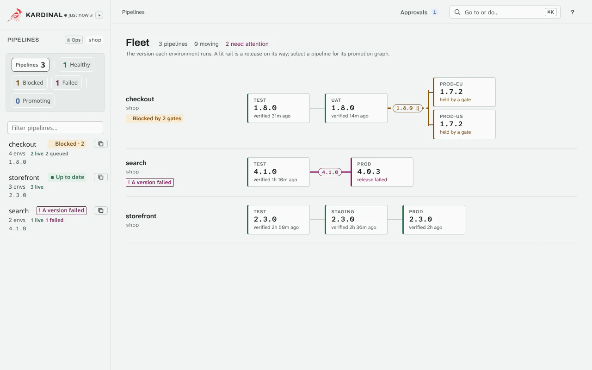
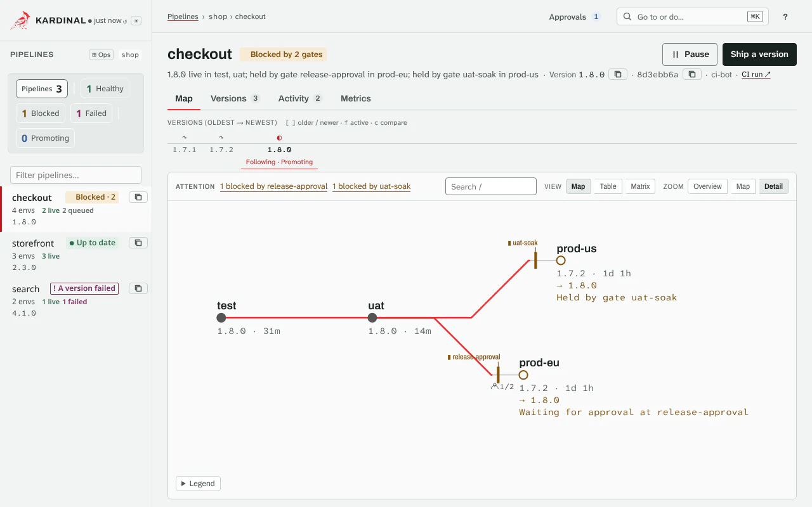
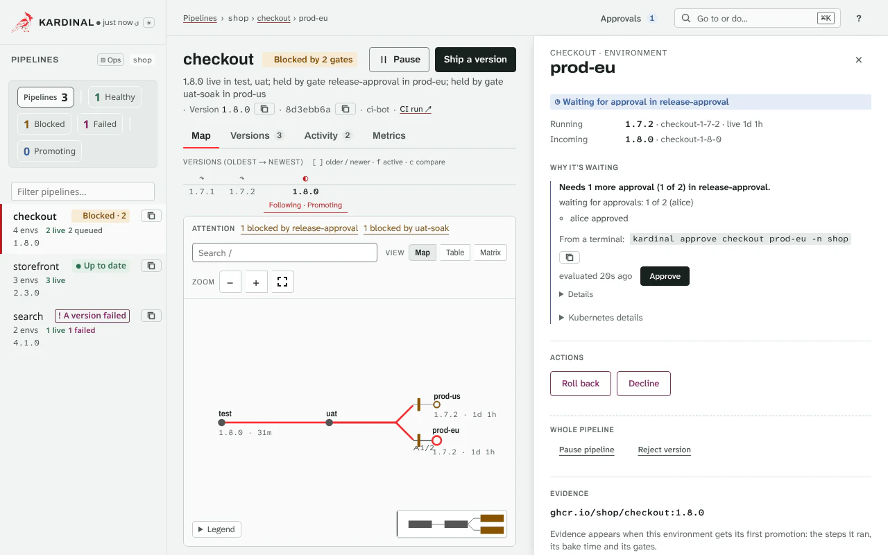
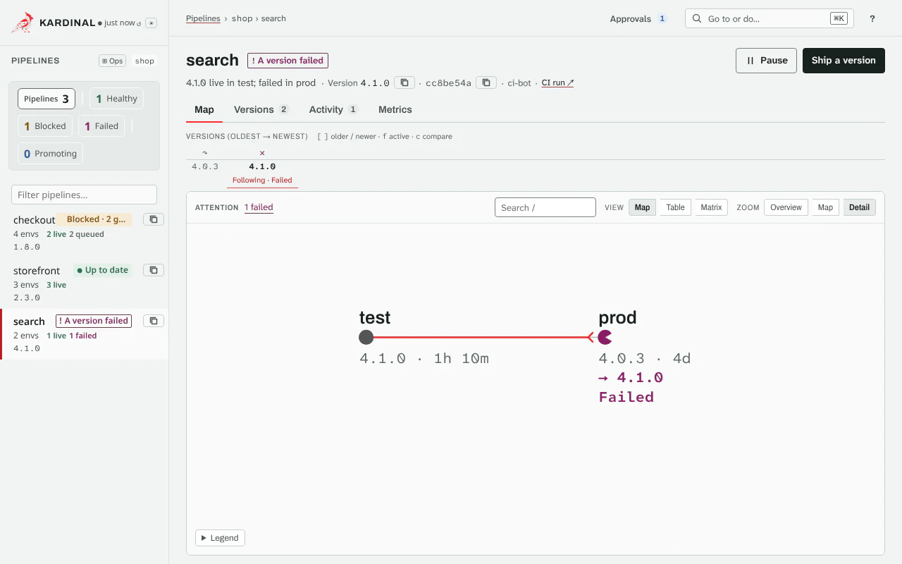

# Use the UI

The controller serves a web UI on port 8082. Open it with a port-forward:

```bash
kubectl port-forward svc/kardinal-promoter -n kardinal-system 8082:8082
```

and browse to <http://localhost:8082/ui/>. To serve it to other clients (an Ingress, a
NodePort), turn on a UI auth mode first: see [Accessing the UI](installation.md#accessing-the-ui).

With `ui.auth.tokenReview` on, the UI reads and acts with your Kubernetes identity, so it shows
and changes what your RBAC allows, as `kubectl` does. A static token (`ui.auth.tokenSecretRef`,
the controller's `--ui-auth-token`) is one token shared by everyone who has it, with no per-user
RBAC.

<figure class="k-demo" data-demo="first-look" hidden>
  <picture>
    <source media="(prefers-reduced-motion: reduce) and (prefers-color-scheme: dark)" srcset="../assets/demos/first-look-dark.png">
    <source media="(prefers-reduced-motion: reduce)" srcset="../assets/demos/first-look.png">
    <source media="(prefers-color-scheme: dark)" srcset="../assets/demos/first-look-dark.webp">
    
  </picture>
  <figcaption>First look · <code>kardinal status my-app</code></figcaption>
</figure>

## Where you are: routes and links

Every screen has its own address, so you can bookmark it, paste it into a ticket, and go Back
and Forward through it. The breadcrumb at the top shows Pipelines › namespace › pipeline ›
environment or version; Pipelines and, below it, the pipeline are links.

| Address | Opens |
|---|---|
| `#/` | Pipelines: every pipeline you can see |
| `#/p/<namespace>/<pipeline>` | A pipeline's map |
| `#/p/<namespace>/<pipeline>/env/<environment>` | The same, with that environment's details open |
| `#/p/<namespace>/<pipeline>/v/<version>` | The same, showing that version (a Bundle name) |

With an environment open, `?v=<version>` gives the version shown.

And after a `?`:

| Parameter | Does |
|---|---|
| `tab=versions`, `tab=activity`, `tab=metrics` | Opens that tab of the pipeline page (no `tab`: the map) |
| `compare=<version>` | Draws a second version beside the one shown, and opens the comparison |
| `node=<gate>` | Opens a gate's details |
| `section=why`, `actions`, `evidence`, `history` | Scrolls an environment's details to that section |
| `view=ops` | The operations table instead of the Pipelines board |
| `filter=…`, `q=…` | The Pipelines filter and search |

For example, `#/p/payments/checkout/env/prod?section=why` opens prod of `checkout` at the
reason it is waiting.

## Pipelines

The start page shows each pipeline as a line of stations, one per environment in promotion
order. Each station names the version it runs and when it was Verified. A pipeline that needs a
person (a failed promotion, a blocking gate, a hold) says so on its line, and the filter at the
top narrows the board to those. **⊞ Ops** in the sidebar (or **Show the operations table** in the palette) lists the same
pipelines as a sortable table.

## The pipeline page

The top line names the pipeline, its state and where its newest version is, with **Pause** and
**Ship a version**. Below it are four tabs: **Map**, **Versions**, **Activity** and **Metrics**.

### Map

The map draws the pipeline as a station map:

- **Stations** are the environments. Each shows the version it runs and, under it, the version on
  its way, with its state in words (Live, Checking health, Waiting for PR merge,
  Waiting for approval at *gate*, ...; [the labels](reference/glossary.md)). The **Legend** under
  the map says what each mark and colour means.
- **The thread** is the version you follow: one red line through every environment it has
  reached. Where it stops, something holds it.
- **Gates** sit on the edge into the environment they guard. A blocking gate is a bar across the
  edge, and an approval gate counts its approvals. Select a gate for its expression and its last
  result.
- **Waves and fleets.** Five or more environments at the same step of the order are one band,
  and a fleet is one platform. Each counts its environments by state; expand it to a grid, a row per state.

<figure class="k-demo" data-demo="fleet" hidden>
  <picture>
    <source media="(prefers-reduced-motion: reduce) and (prefers-color-scheme: dark)" srcset="../assets/demos/fleet-dark.png">
    <source media="(prefers-reduced-motion: reduce)" srcset="../assets/demos/fleet.png">
    <source media="(prefers-color-scheme: dark)" srcset="../assets/demos/fleet-dark.webp">
    
  </picture>
  <figcaption>A fleet · <code>kardinal status my-app</code></figcaption>
</figure>

- **Needs attention.** A strip above the map counts what needs a look: failed environments,
  environments blocked by each gate, held environments and environments that wait. Select an item to go to it.
- **Search** matches environment and target names, versions, version (Bundle) names, gate names
  and gate expressions; Enter and Shift+Enter move through the matches.
- **Zoom.** The map has three levels:
    - **Detail**: every station with its version, what is on its way and its state, and Promote,
      Roll back and Release hold under the station in focus.
    - **Map**: names, and a version only where it differs from the environment before.
    - **Overview**: the shape, with names only on the stations the thread passes, the one in
      focus, and those that failed or are held.

    It opens at Detail for up to 8 environments, at Map up to 40, and at Overview above that. On a
    narrow map (below 720 pixels) that does not fit at its level, it opens a level lower. A label
    that would overlap a more important one is hidden until you point at or focus its station.
    Drag to pan; zoom with the wheel, a pinch, or the level buttons. A **minimap** in the corner
    shows where you are on a large map (it hides while part of the map is under it); select a
    point to move there.

**Compare two versions.** On the version rail above the map, select one version and Shift-select
a second, then **Compare**: the second version's route is drawn as a dashed ink thread, and the
comparison lists what differs (images, environments, provenance).

<figure class="k-demo" data-demo="compare" hidden>
  <picture>
    <source media="(prefers-reduced-motion: reduce) and (prefers-color-scheme: dark)" srcset="../assets/demos/compare-dark.png">
    <source media="(prefers-reduced-motion: reduce)" srcset="../assets/demos/compare.png">
    <source media="(prefers-color-scheme: dark)" srcset="../assets/demos/compare-dark.webp">
    
  </picture>
  <figcaption>Compare · <code>kardinal diff my-app-a my-app-b</code></figcaption>
</figure>

### An environment's details

Select a station (or press Enter on it) to open its details, beside the map on a wide screen and
as a sheet over it on a narrow one:

- **Why it's waiting** comes first: the gate that blocks and its reason, the approvals still
  needed, the pull request to merge, the health check in progress. When nothing waits, this is
  the environment's status.

<figure class="k-demo" data-demo="why-waiting" hidden>
  <picture>
    <source media="(prefers-reduced-motion: reduce) and (prefers-color-scheme: dark)" srcset="../assets/demos/why-waiting-dark.png">
    <source media="(prefers-reduced-motion: reduce)" srcset="../assets/demos/why-waiting.png">
    <source media="(prefers-color-scheme: dark)" srcset="../assets/demos/why-waiting-dark.webp">
    
  </picture>
  <figcaption>Why it's waiting · <code>kardinal explain my-app prod</code></figcaption>
</figure>

- **Actions** for that environment. Each one asks before it acts, and the button, the question
  and the result use the same verb:

    | Action | Asks for |
    |---|---|
    | Approve, Decline | an optional comment |
    | Override gate | the gate, how long, and a reason |
    | Promote | a confirmation |
    | Roll back | the version to roll back to, and a reason when you hold the environment on it |
    | Release hold | a confirmation |
    | Pause pipeline, Resume pipeline | a confirmation |
    | Reject version | a reason |

<figure class="k-demo" data-demo="approve-override" hidden>
  <picture>
    <source media="(prefers-reduced-motion: reduce) and (prefers-color-scheme: dark)" srcset="../assets/demos/approve-override-dark.png">
    <source media="(prefers-reduced-motion: reduce)" srcset="../assets/demos/approve-override.png">
    <source media="(prefers-color-scheme: dark)" srcset="../assets/demos/approve-override-dark.webp">
    
  </picture>
  <figcaption>Approve and override · <code>kardinal approve</code>, <code>kardinal override</code></figcaption>
</figure>

<figure class="k-demo" data-demo="rollback-hold" hidden>
  <picture>
    <source media="(prefers-reduced-motion: reduce) and (prefers-color-scheme: dark)" srcset="../assets/demos/rollback-hold-dark.png">
    <source media="(prefers-reduced-motion: reduce)" srcset="../assets/demos/rollback-hold.png">
    <source media="(prefers-color-scheme: dark)" srcset="../assets/demos/rollback-hold-dark.webp">
    
  </picture>
  <figcaption>Roll back and hold · <code>kardinal rollback my-app prod --hold --reason "…"</code></figcaption>
</figure>


- **Evidence**: the images of the version on its way, the steps the promotion ran with their
  durations, its bake time and its gates.
- **History**: the promotion's Kubernetes events in this environment.

### Versions

Every version of the pipeline, newest first, with its state and commit. Select one to show it on
the map.

### Activity

What went wrong and what holds: failed promotions grouped across environments (select one to open
its environment on the map), and the gates of the version shown, with their conditions and
approvals.

### Metrics

Release metrics over the last versions: the time to reach the final environments, the deploys
that reached them and the rollback rate, and the change failure rate and time to restore from
the pipeline's DORA metrics ([Monitor](guides/monitoring.md)).

## The palette and keyboard

Press **⌘K** (Ctrl+K) anywhere to open the palette. Type to filter; ↑ and ↓ move, Enter runs, Esc
closes.

- **Go to**: Pipelines, any pipeline, any pipeline › environment, and the versions of the pipeline
  you are on.
- **Do**: switch the theme (System, Light, Dark), switch the density (comfortable or compact),
  refresh now, show the operations table or the board, and show the keyboard shortcuts.

The palette never changes a promotion by itself: Promote, Roll back and Pause keep their own
confirmation.

<figure class="k-demo" data-demo="palette" hidden>
  <picture>
    <source media="(prefers-reduced-motion: reduce) and (prefers-color-scheme: dark)" srcset="../assets/demos/palette-dark.png">
    <source media="(prefers-reduced-motion: reduce)" srcset="../assets/demos/palette.png">
    <source media="(prefers-color-scheme: dark)" srcset="../assets/demos/palette-dark.webp">
    
  </picture>
  <figcaption>The palette · ⌘K</figcaption>
</figure>

| Key | Anywhere |
|---|---|
| ⌘K, Ctrl+K | Open the palette |
| `/` | Focus the pipeline search |
| `?` | Show or hide the shortcuts |
| `r` | Refresh now |
| Esc | Close the open panel |

| Key | On the map |
|---|---|
| ← → ↑ ↓ | Move between stations (and through an expanded group's grid) |
| Home, End | The first or the last station |
| Enter | Open the environment's details (on a group: expand or collapse it) |
| Space | Expand or collapse the group |
| `e` | Expand every group that has something failed, blocked or held |
| Shift+E | Collapse every group |
| `+`, `-` | Zoom in, out |
| `0` | Fit the map |
| `/` | Focus the map search (not the pipeline search) |
| Esc | Clear the search; else close the open popover; else fit the map. The next Esc closes the environment's details |

Shortcuts do nothing while you type in a field or while a dialog is open.

## On a narrow screen

Below 960 pixels the pipeline list moves behind the menu button at the top left, and an
environment's details open as a sheet over the map below 1280 pixels. The map keeps its zoom and
search; pinch to zoom.

## Themes and density

The theme follows your system until you pick Light or Dark (the theme button or the palette), and
the choice is kept in this browser. Compact density fits more on the screen.
